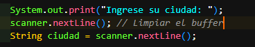

# Saltos de linea del scanner

nextLine = salto de linea de un texto.
nextInt = salto de linea de un numero entero
nextDouble = salto de linea de un double
nextBoolean = salto de linea de un false o true

- Despues de un nextLine y hay un nextInt
hay que limpiar con buffer.

- Porque si no lo limpiamos no pedira al usuario que introdusca ciudad.
  
# Scanner

Scanner permite introducir datos al usuario.

    - ej: Scanner Descripcion = new Scanner(System.in)
    - Scanner = tipo de obj que vamos a utilizar
    - Descripcion = nombre que le damos al Scanner
    - newScanner = crea un obj nuevo
    - System.in = indica que los datos entran por descripcion 

- las condiciones devuelven true o false
- if/else permite tomar decisiones.

# Para no tener numero infinitos 

Usamos $%.2f%n .

el 2 significa cuanto numero queremos despues del punto.

# nota 19:10 - 29/10/26
revisar el ejercicio p3 porque ahi alguna cosa que no me encanja en el y es ( %s) y que si quito la primera variable y dejo una me da error.

me ire a comer sushi luego vuelvo

# notas del dia 30-10-26

- 