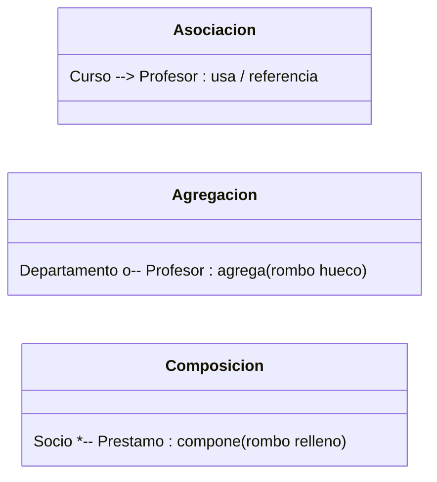

# 📘 Apuntes Día 3: Relaciones entre Clases en POO

> **Tema:** Asociación, Agregación y Composición en Java.  
> **Objetivo:** Comprender cómo interactúan, se relacionan y dependen unas clases de otras en el diseño orientado a objetos.

---

## 🧭 Resumen Rápido de un Vistazo

| Relación | Tipo de Vínculo | Ciclo de Vida Independiente | Frase Clave | Ejemplo Cotidiano |
| :--- | :---: | :---: | :--- | :--- |
| **Asociación** | Débil ("Conoce a") | ✅ Sí (ambos independientes) | *"Un objeto usa o conoce a otro"* | Un `Curso` tiene un `Profesor` tutor. |
| **Agregación** | Medio ("Tiene un...") | ✅ Sí (la parte sobrevive) | *"El todo agrupa partes independientes"* | Un `Departamento` agrupa `Profesores`. |
| **Composición** | Fuerte ("Parte de...") | ❌ No (la parte muere con el todo) | *"La parte no existe sin el todo"* | Una `LíneaDePedido` en un `Pedido`. |



---

## 1. 🔗 Asociación

### ¿Qué es?
Es la relación más básica y general entre dos clases. Ocurre simplemente cuando **una clase mantiene una referencia a otra** para interactuar con ella.

### Tipos de Asociación:
* **Unidireccional:** La `Clase A` tiene referencia a la `Clase B`, pero `B` no sabe nada de `A`.
* **Bidireccional:** La `Clase A` conoce a la `Clase B` y la `Clase B` también conoce a la `Clase A`.

### 💻 Ejemplo en Java:
```java
// Clase independiente
static class Profesor {
    final String nombre;

    Profesor(String nombre) {
        this.nombre = nombre;
    }
}

// Curso se ASOCIA con Profesor (guarda una referencia a su tutor)
static class Curso {
    final String titulo;
    Profesor tutor; // Asociación unidireccional: Curso conoce a Profesor

    Curso(String titulo, Profesor tutor) {
        this.titulo = titulo;
        this.tutor = tutor;
    }
}
```

---

## 2. 🧩 Agregación (Relación "Todo - Parte" Débil)

### ¿Qué es?
Es una variante de la asociación donde un objeto contenedor (el **todo**) agrupa a varios objetos contenidos (las **partes**), pero **las partes pueden existir independientemente del todo**.

> 💡 **Regla de oro:** Si eliminas el objeto contenedor, las partes **no** se destruyen, continúan existiendo por su cuenta.

### 🏢 Ejemplo Real:
* Un `Departamento` universitario agrupa a varios `Profesores`.
* Si el `Departamento` se disuelve o cierra, los `Profesores` **siguen existiendo** como empleados o profesionales.

### 💻 Ejemplo en Java:
```java
import java.util.ArrayList;
import java.util.List;

static class Departamento {
    final String nombre;
    // Lista de profesores agregados
    private final List<Profesor> profesores = new ArrayList<>();

    Departamento(String nombre) {
        this.nombre = nombre;
    }

    // Incorpora un profesor ya existente en el sistema
    void incorporar(Profesor p) {
        profesores.add(p);
    }

    int total() {
        return profesores.size();
    }
}
```

---

## 3. 🧬 Composición (Relación "Todo - Parte" Fuerte)

### ¿Qué es?
Es la relación más estricta de todas. Las partes forman un componente inseparable del todo:
* **Las partes no tienen sentido fuera del todo.**
* **El ciclo de vida de la parte está ligado al del todo:** si el objeto contenedor se destruye, sus partes se destruyen con él.

> ⚠️ **Regla de oro:** La parte "nace" y "muere" dentro del contenedor. Nadie más debería compartir o gestionar directamente esa parte.

### 🧾 Ejemplos Reales:
* **Líneas de pedido y Pedido:** Si borras un pedido de compra, cada una de sus líneas de artículo deja de tener sentido de existir.
* **Socio y sus Préstamos:** El historial de préstamos pertenece exclusivamente a la ficha de ese socio.

### 💻 Ejemplo en Java:
```java
import java.util.ArrayList;
import java.util.List;

// Modelo auxiliar de un Préstamo
static class Prestamo {
    final String libro;
    boolean activo;

    Prestamo(String libro, boolean activo) {
        this.libro = libro;
        this.activo = activo;
    }
}

// Socio con Composición sobre sus Préstamos
static class Socio {
    final String nombre;
    // COMPOSICIÓN: La lista de préstamos nace ligada al socio
    private final List<Prestamo> prestamos = new ArrayList<>();

    Socio(String nombre) {
        this.nombre = nombre;
    }

    // Cuenta cuántos préstamos tiene actualmente activos
    long activos() {
        return prestamos.stream()
                        .filter(p -> p.activo)
                        .count();
    }

    // Devuelve una copia protegida del historial (inmutable)
    List<Prestamo> historial() {
        return List.copyOf(prestamos);
    }
}
```

---

## 📌 Chuleta Resumen para Examen / Entrevistas

> [!TIP]
> Pregúntate siempre sobre el **ciclo de vida**:
> 1. ¿Si destruyo al padre, el hijo sigue teniendo sentido y vida propia?  
>    - **Sí** 👉 **Agregación** (ej. Coche y Ruedas, o Departamento y Empleado).  
>    - **No** 👉 **Composición** (ej. Casa y Habitaciones, o Factura y Líneas de Factura).
