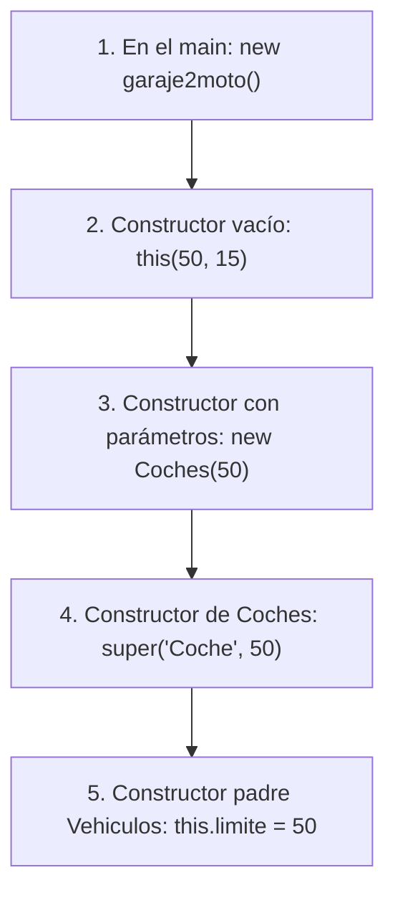

# 📘 Cuaderno de Dudas y Respuestas: Ejercicio `garaje2moto.java`

> **Para qué sirve esta guía:**  
> Este documento recopila **todas las dudas, preguntas y conceptos clave** que surgieron mientras construíamos y analizábamos el ejercicio `garaje2moto.java`.  
> Guárdalo como tu "chuleta" o manual de cabecera. Si en el futuro dudas de qué hace una palabra rara (`trim`, `super`, `this`, `equalsIgnoreCase`, `try-catch`, etc.), ven directamente a esta guía.

---

## 📑 Índice Rápido de Dudas

1. [Duda 1: ¿Siempre tengo que poner estos métodos o es solo por este ejercicio?](#duda-1-siempre-tengo-que-poner-estos-métodos-o-es-solo-por-este-ejercicio)
2. [Duda 2: ¿Cómo sabe el programa que son 50 coches y 15 motos si no veo que llame a las constantes?](#duda-2-cómo-sabe-el-programa-que-son-50-coches-y-15-motos-si-no-veo-que-llame-a-las-constantes)
3. [Duda 3: ¿Qué hacen exactamente métodos como `cuantosCochesHay()`, `entrarMoto()`, etc.? (El Patrón Delegación)](#duda-3-qué-hacen-exactamente-métodos-como-cuantoscocheshay-entrarmoto-etc-el-patrón-delegación)
4. [Duda 4: ¿Por qué hay un `\n` dentro de `System.out.println("\n====")`?](#duda-4-por-qué-hay-un-n-dentro-de-systemoutprintlnn)
5. [Duda 5: ¿Qué es y qué hace `.trim()` en `sc.nextLine().trim()`?](#duda-5-qué-es-y-qué-hace-trim-en-scnextlinetrim)
6. [Duda 6: ¿Qué hace `equalsIgnoreCase` y qué significa `||`? ¿Significa "diferente"?](#duda-6-qué-hace-equalsignorecase-y-qué-significa--significa-diferente)
7. [Duda 7: ¿Qué significa `if (this.led != null)` y qué es `!= null`?](#duda-7-qué-significa-if-thisled--null-y-qué-es--null)
8. [Duda 8: Cuando saco un coche sale `Salió Coche. Dentro: 0 | Total salidos: 1`. ¿De dónde sale esa línea?](#duda-8-cuando-saco-un-coche-sale-salió-coche-dentro-0--total-salidos-1-de-dónde-sale-esa-línea)
9. [Duda 9: ¿Cómo funciona el `try-catch` y de dónde sale `e.getMessage()`?](#duda-9-cómo-funciona-el-try-catch-y-de-dónde-sale-egetmessage)
10. [Duda 10: ¿Qué significa exactamente `public static void main(String[] args)`?](#duda-10-qué-significa-exactamente-public-static-void-mainstring-args)

---

## Duda 1: ¿Siempre tengo que poner estos métodos o es solo por este ejercicio?

> **Tu duda:** *"¿O sea que siempre esos métodos van allí? ¿Hago otro ejercicio y tengo que usarlos? ¿O es porque es este ejercicio?"*

### 💡 La Respuesta:
**No son obligatorios en todos los ejercicios.** Los métodos que creas dependen del **problema de la vida real** que estás modelando:

* Si estás haciendo un programa de un **Banco**, tus métodos serán `ingresarDinero()`, `retirarDinero()` y `consultarSaldo()`.
* Si estás haciendo un programa de una **Escuela**, tus métodos serán `matricularAlumno()`, `ponerNota()` y `listarAprobados()`.
* En este ejercicio de un **Garaje**, el problema exige controlar vehículos, por eso creamos `entrarCoche()`, `salirCoche()`, `cuantosCochesHay()`, etc.

### Lo que SÍ se repite siempre en la Programación Orientada a Objetos:
Lo que es una regla general en cualquier ejercicio son los **tipos de métodos**:
1. **Métodos de acción (Verbos):** Hacen que las cosas cambien (`entrar()`, `salir()`, `pagar()`).
2. **Métodos de consulta (Getters):** Preguntan información privada sin modificarla (`cuantosHay()`, `getLimite()`, `getColor()`).

---

## Duda 2: ¿Cómo sabe el programa que son 50 coches y 15 motos si no veo que llame a las constantes?

> **Tu duda:** *"En el constructor `public garaje2moto(int limiteCoches, int limiteMotos)` no veo que pongamos 50 ni 15, ¿cómo sabe fijarle los 50?"*

### 💡 La Respuesta:
Es una **carrera de relevos** (en programación se llama **Encadenamiento de Constructores** o *Constructor Chaining*).

Mira el camino exacto que recorre el número 50:



### El código paso a paso:
1. En la clase `garaje2moto` definiste las constantes fijas arriba:
   ```java
   public static final int PLAZAS_FIJAS_COCHES = 50;
   public static final int PLAZAS_FIJAS_MOTOS = 15;
   ```
2. Cuando el `main` hace `new garaje2moto()`, entra al constructor vacío:
   ```java
   public garaje2moto() { 
       this(PLAZAS_FIJAS_COCHES, PLAZAS_FIJAS_MOTOS); // <-- ¡AQUÍ PASA EL 50 Y EL 15!
   }
   ```
   Ese `this(...)` llama de inmediato al constructor de abajo:
   ```java
   public garaje2moto(int limiteCoches, int limiteMotos) { 
       // limiteCoches vale 50, limiteMotos vale 15
       this.seccionCoches = new Coches(limiteCoches);    // Le entrega el 50 al Coche
       this.seccionMotos = new Motocicletas(limiteMotos); // Le entrega el 15 a la Moto
   }
   ```
3. `new Coches(50)` llama al constructor de la clase `Coches`:
   ```java
   public Coches(int limite) { // limite recibe 50
       super("Coche", limite); // 'super' le pasa el 50 a la clase padre Vehiculos
   }
   ```
4. Y por fin, la clase padre `Vehiculos` guarda el número en su caja fuerte:
   ```java
   public Vehiculos(String tipo, int limite) {
       this.limite = limite; // this.limite queda guardado para siempre en 50
   }
   ```

---

## Duda 3: ¿Qué hacen exactamente métodos como `cuantosCochesHay()`, `entrarMoto()`, etc.? (El Patrón Delegación)

> **Tu duda:**  
> ```java
> public int cuantosCochesHay() { 
>     return this.seccionCoches.cuantosHay(); 
> } 
> public void entrarMoto() { 
>     this.seccionMotos.entrar(); 
> }
> ```
> *"¿Por qué escribimos esto si parece que no hace nada nuevo?"*

### 💡 La Respuesta: La Metáfora del Recepcionista
Imagina un hotel grande con un **Director General** (la clase `garaje2moto`), un **Jefe de Planta de Coches** (`seccionCoches`) y un **Jefe de Planta de Motos** (`seccionMotos`):

1. Un cliente llega a recepción y pregunta al Director: *"¿Cuántos coches hay dentro?"*.
2. El Director General no va personalmente a contar coche por coche. Tiene a un especialista encargado.
3. El Director descuelga el teléfono y le pregunta al Jefe de Coches:
   `return this.seccionCoches.cuantosHay();`
4. El especialista le dice: *"Hay 12"*, y el Director le contesta al cliente: *"Hay 12"*.

### ¿Por qué se hace así en Java? (Principio de Encapsulamiento):
Porque los atributos `seccionCoches` y `seccionMotos` están protegidos como `private`. Desde fuera del garaje nadie tiene permiso para tocarlos directamente. El garaje actúa de **puerta de entrada segura (Fachada)**.

---

## Duda 4: ¿Por qué hay un `\n` dentro de `System.out.println("\n====")`?

> **Tu duda:** *"¿Por qué hay un `/n` aquí?"*

### 💡 La Respuesta:
`\n` es un carácter especial de escape en programación que significa: **Salto de Línea (Enter / New Line)**.

* Si imprimes:
  ```java
  System.out.println("Opción 1");
  System.out.println("=================");
  ```
  Saldrá todo pegado:
  ```text
  Opción 1
  =================
  ```
* Si le pones `\n`:
  ```java
  System.out.println("\n=================");
  ```
  Java pulsa la tecla "Enter" antes de dibujar las rayas, dejando una línea en blanco para que la pantalla se vea limpia y elegante:
  ```text
  Opción 1

  =================
  ```

> ⚠️ **Atención a la barra:** Se escribe con la barra invertida `\` (`\n`), no con la barra normal `/`.

---

## Duda 5: ¿Qué es y qué hace `.trim()` en `sc.nextLine().trim()`?

> **Tu duda:** *"¿trim qué es?"*

### 💡 La Respuesta:
`.trim()` es un método de Java para textos (`String`) que **recorta y elimina todos los espacios en blanco invisibles sobrantes** al principio y al final.

### Ejemplo real:
Imagina que el usuario tiene el dedo torpe en el teclado y escribe:
```text
"   1   "  (espacio, espacio, espacio, 1, espacio, espacio)
```
* **Sin `.trim()`:** Java ve `"   1   "`. Como no es exactamente `"1"`, tu menú daría error: *"Opción inválida"*.
* **Con `.trim()`:** Java quita la basura de los bordes y deja `"1"` impecable.

```java
String textoSucio = "   coche   ";
String textoLimpio = textoSucio.trim(); // Se convierte en "coche"
```

---

## Duda 6: ¿Qué hace `equalsIgnoreCase` y qué significa `||`? ¿Significa "diferente"?

> **Tu duda:**  
> ```java
> if (tipo.equals("1") || tipo.equalsIgnoreCase("coche"))
> ```
> *"Entiendo que decimos si tipo es igual a 1 o diferente a coche entrar a coche. ¿Es eso?"*

### 💡 La Respuesta:
**No significa diferente.** 

Vamos a romper esa línea en sus dos operadores:

### 1. El operador `||` significa "O" (OR lógico en inglés):
* Significa: *"Si se cumple la condición A **O** si se cumple la condición B (con que una de las dos sea verdad, entra)"*.
* El símbolo de "diferente" en Java no es `||`, es `!=` o `!texto.equals(...)`.

### 2. `equalsIgnoreCase`:
En Java:
* `.equals("coche")` es súper estricto: si el usuario escribe `"COCHE"` en mayúsculas, dirá que NO es igual.
* `.equalsIgnoreCase("coche")` significa: **compara si el texto dice "coche" IGNORANDO si son mayúsculas o minúsculas**.

### Traducción al español llano:
```java
if (tipo.equals("1") || tipo.equalsIgnoreCase("coche"))
```
> *"Si lo que tecleó el usuario es un número `"1"` **O BIEN** si escribió la palabra `"coche"` (ya sea en mayúsculas `"COCHE"`, minúsculas `"coche"` o mixto `"Coche"`), entonces ejecuta `entrarCoche()`"*.

---

## Duda 7: ¿Qué significa `if (this.led != null)` y qué es `!= null`?

> **Tu duda:** *"¿Por qué ponemos `this.led != null` antes de actualizar el semáforo?"*

### 💡 La Respuesta:
`null` en Java significa **vacío, no existe, la nada absoluta**.

* El símbolo `!=` significa: **"NO ES IGUAL A"** o **"ES DISTINTO DE"**.
* Por lo tanto, `this.led != null` se traduce como: **"Si el semáforo LED existe (no está vacío)"**.

### ¿Para qué sirve? (Evitar que el programa muera):
Si en un garaje no compramos semáforo LED (`led = null`), e intentamos hacer:
```java
this.led.actualizarColor(10); // ¡¡CRASH!!
```
Java se congela de golpe y arroja el error más famoso del mundo: `NullPointerException` (intentar darle órdenes a un fantasma que no existe en memoria).

Al poner:
```java
if (this.led != null) {
    this.led.actualizarColor(...);
}
```
Nos aseguramos de que solo le mande órdenes si de verdad hay una bombilla conectada. A esto los programadores le llamamos **Programación Defensiva**.

---

## Duda 8: Cuando saco un coche sale `Salió Coche. Dentro: 0 | Total salidos: 1`. ¿De dónde sale esa línea?

> **Tu duda:** *"Cuando imprimo sale esa línea, ¿de dónde sale?"*

### 💡 La Respuesta:
Sale de adentro del método `salir()` en la clase padre `Vehiculos`.

Mira cómo viaja la orden cuando pulsas la opción 2 (Salida):

```mermaid
sequenceDiagram
    participant Usuario
    participant Menu as Menú Consola
    participant Garaje as garaje2moto
    participant Seccion as seccionCoches (Coches)
    participant Padre as Vehiculos (Superclase)

    Usuario->>Menu: Teclea "1" (Coche)
    Menu->>Garaje: garaje.salirCoche()
    Garaje->>Seccion: this.seccionCoches.salir()
    Seccion->>Padre: Ejecuta salir() heredado
    Note over Padre: this.dentro--;<br/>this.queSalieron++;
    Padre-->>Usuario: System.out.println("Salió Coche. Dentro: 0 | Total salidos: 1");
    Garaje->>Garaje: led.actualizarColor()
    Garaje-->>Usuario: System.out.println("Semáforo LED actualizado a: VERDE");
```

### El código exacto en `Vehiculos`:
```java
public void salir() { 
    if (this.dentro <= 0) { 
        throw new IllegalStateException("Error: No hay ningún " + this.tipo + " dentro..."); 
    } 
    this.dentro--;          // Resta 1 a los que están dentro
    this.queSalieron++;     // Suma 1 al historial de salidas
    
    // ¡AQUÍ ESTÁ LA LÍNEA QUE PREGUNTABAS!
    System.out.println("Salió " + this.tipo + ". Dentro: " + this.dentro + " | Total salidos: " + this.queSalieron); 
}
```

---

## Duda 9: ¿Cómo funciona el `try-catch` y de dónde sale `e.getMessage()`?

> **Tu duda:** *"¿Cómo viaja el error y qué es `e.getMessage()`?"*

### 💡 La Respuesta: La Red de Trapecista
En Java, cuando ocurre algo que no se debe permitir (por ejemplo, el garaje tiene 50 plazas y quieren meter el coche 51), lanzamos una alarma con `throw`:

```java
// 1. DENTRO DE LA CLASE VEHICULOS:
if (this.dentro >= this.limite) {
    throw new IllegalStateException("Error: El espacio de Coche está lleno (50 plazas). Entrada denegada.");
}
```

* `throw`: Es como lanzar una granada con el mensaje dentro.
* Si nadie atrapa la granada, explota y cierra la consola con un texto rojo horrible.
* Por eso en el menú colocamos un **bloque `try-catch`**:

```java
// 2. EN EL MENÚ:
try {
    entrarCoche(); // Intenta meter el coche
} catch (IllegalStateException e) {
    // Si entró en throw, la granada cae aquí en la variable 'e'
    System.out.println(e.getMessage()); // Lee la nota pegada a la granada e imprímela amablemente
}
```

* `e`: Es el objeto de la excepción que fue lanzada.
* `e.getMessage()`: Es el método que saca el texto que escribimos entre comillas arriba.
* **Resultado:** El usuario ve el mensaje de error en la pantalla, pero el programa **no se cae ni se cierra**, sino que vuelve a mostrar el menú tranquilamente.

---

## Duda 10: ¿Qué significa exactamente `public static void main(String[] args)`?

> **Tu duda:** *"Explícame esto: el punto de arranque del programa"*

### 💡 La Respuesta: Disección palabra por palabra

| Palabra | Qué significa | Metáfora sencilla |
| :--- | :--- | :--- |
| **`public`** | Visible para todo el mundo exterior. | La puerta del edificio está abierta para que la Máquina Virtual de Java (JVM) pueda entrar. |
| **`static`** | No necesita crear un objeto previo para poder ejecutarse. | Es como el timbre de la calle: puedes tocarlo sin haber entrado antes a la casa. |
| **`void`** | "Vacío". Significa que el método no devuelve ningún número ni texto al terminar. | Hace su trabajo y no retorna nada (`return`). |
| **`main`** | "Principal". Es el nombre sagrado que busca Java. | Si le cambias el nombre a `inicio()` o `arrancar()`, Java dirá: *"No encuentro el main, no sé arrancar"*. |
| **`String[] args`** | Lista de argumentos o palabras que alguien podría pasarle por la terminal al arrancar el programa. | Una mochila para recibir parámetros desde la consola (normalmente vacía en ejercicios de clase). |

### Las dos líneas que pusimos dentro del `main`:
```java
public static void main(String[] args) { 
    garaje2moto garaje = new garaje2moto(); // 1. Construye el edificio con sus 50 coches, 15 motos y semáforo en la memoria RAM
    garaje.iniciarConsola();                // 2. Enciende la pantalla y muestra el menú interactivo para que el usuario pueda escribir
}
```

---

## 🎯 Resumen Mental para el Examen / Preguntas del Profesor

Si el profesor te señala cualquier línea del código, recuerda estas 3 claves maestras:

1. **`Vehiculos` es el Padre (Superclase):** Tiene la lógica común (`dentro`, `queSalieron`, `entrar()`, `salir()`).
2. **`Coches` y `Motocicletas` son Hijas (Subclases):** Usan `extends` y `super(...)` para heredar todo lo del padre sin repetir código.
3. **`garaje2moto` es el Coordinador (Fachada):** Tiene un objeto `Coches`, un objeto `Motocicletas` y un `SemaforoLed`. Conecta la consola con ellos mediante **delegación**.

---
*Documento generado y archivado para el repositorio Asturnet - Semana 2.*
