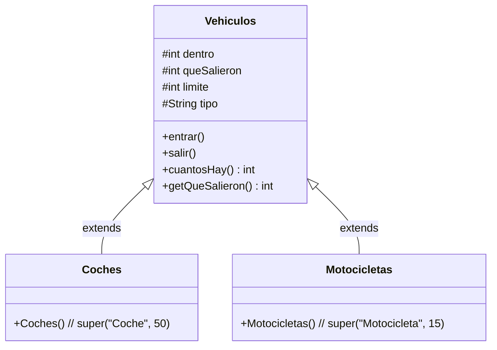

# 📋 Tarea 2: Ampliación del Garaje con Motocicletas y Herencia

> **Archivo de resolución:** [`garaje2moto.java`](./garaje2moto.java)

---

## 🎯 Enunciado

Añadir al código anterior del garaje la clase **`Motocicletas`** con el mismo funcionamiento que los coches, pero con un **límite de 15**, y **`Vehiculos` como superclase de ambas**.

---

## 🏗️ Arquitectura de la Solución

### Puntos clave implementados:
1. **Superclase `Vehiculos`:** Centraliza toda la lógica de control de aforo, incremento/decremento y las excepciones (`IllegalStateException`).
2. **Subclase `Coches`:** Hereda de `Vehiculos` pasando su límite propio de **50**.
3. **Subclase `Motocicletas`:** Hereda de `Vehiculos` pasando su límite propio de **15**.
4. **Clase `garaje2moto`:** Gestiona independientemente ambas zonas de aparcamiento y mantiene el semáforo LED.
