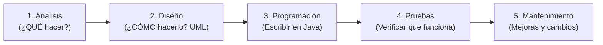
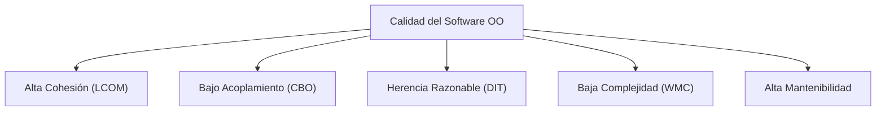

# 📘 Tema 1: Ciclo de Vida del Software, Extracción de Clases y Métricas OO

> **Correspondencia con el Manual Oficial UF2404:** Páginas 7 a 11.  
> **Objetivo:** Entender cómo se pasa de un texto o encargo de cliente a clases reales en Java, qué es un mensaje y cómo medir la calidad de tu código según los estándares de la industria.

---

## 🔄 1. El Ciclo de Desarrollo del Software con Objetos

En la industria profesional, programar **no es solo ponerse a teclear código**. Escribir código en Java es únicamente la tercera fase de un proceso completo:



### ¿Por qué la Programación Orientada a Objetos (POO) es superior aquí?
En la programación clásica de los años 80, cada fase usaba un idioma distinto.  
En POO ocurre algo mágico llamado **continuidad del vocabulario**:
* En el **Análisis**, el cliente te habla de: *"Socio"*, *"Libro"*, *"Préstamo"*.
* En el **Diseño**, tus cajas de UML se llaman: `Socio`, `Libro`, `Prestamo`.
* En la **Programación**, tus archivos en Java se llaman literalmente: `Socio.java`, `Libro.java`, `Prestamo.java`.

---

## 🔍 2. Del Problema a las Clases: Técnica de Sustantivos y Verbos

Cuando el profesor te entregue un enunciado largo en un examen o práctica, utiliza esta técnica sistemática para no quedarte bloqueado:

1. **Subraya todos los SUSTANTIVOS:** Son los candidatos a ser **Clases** o **Atributos**.
2. **Subraya todos los VERBOS:** Son los candidatos a ser los **Métodos** (las acciones).
3. **Filtra lo irrelevante:** Descarta los sustantivos que sean detalles secundarios o datos temporales.

### Caso Práctico del Manual (La Biblioteca):
> *"Una **biblioteca** presta **libros** a sus **socios**. Cada **préstamo** tiene una **fecha de devolución**."*

| Sustantivos encontrados | ¿Qué se convierte en el código? |
| :--- | :--- |
| `Biblioteca`, `Libro`, `Socio`, `Prestamo` | **Clases en Java** (`class Socio`, `class Libro`...) |
| `fechaDevolucion`, `nombre`, `isbn` | **Atributos** (`private LocalDate fechaDevolucion;`) |

| Verbos encontrados | ¿Qué se convierte en el código? |
| :--- | :--- |
| `prestar`, `devolver`, `estaDisponible` | **Métodos** (`public void prestar(Libro libro)`) |

---

## ✉️ 3. Conceptos Básicos: Objeto, Clase y MENSAJE

Muchas personas confunden la llamada a un método con una simple función de matemáticas. En POO formal, la comunicación se define mediante **Mensajes**:

$$\text{POO} = \text{Objetos} + \text{Mensajes}$$

* **Objeto:** Tiene **identidad** (su lugar único en la memoria RAM), un **estado** (el valor actual de sus atributos) y un **comportamiento** (sus métodos).
* **Clase:** La plantilla o molde que describe cómo serán esos objetos.
* **Mensaje:** La orden o petición que un objeto emite hacia otro para que ejecute una acción:
  ```java
  cuentaAna.retirar(100);
  // Objeto receptor: cuentaAna
  // Mensaje enviado: retirar
  // Parámetro / dato adjunto: 100
  ```

---

## 📊 4. Calidad del Software y Métricas Orientadas a Objetos

El manual oficial señala que un buen programa no se evalúa por lo largo que sea, sino por **5 atributos de calidad y sus métricas formales**:



### 1. Cohesión (Métrica LCOM - *Lack of Cohesion of Methods*)
* **¿Qué significa?** Que todos los atributos y métodos dentro de una misma clase deben tener relación directa entre sí. Hablan de un solo tema.
* **Mal ejemplo:** Una clase `Usuario` que guarda el nombre, pero que también contiene métodos para calcular el IVA de las facturas y enviar correos al servidor SMTP.
* **Buen ejemplo:** La clase `SemaforoLed` de nuestro garaje solo se preocupa de la luz del semáforo.
* **Regla de oro:** **Buscamos ALTA COHESIÓN** (bajo LCOM).

---

### 2. Acoplamiento (Métrica CBO - *Coupling Between Objects*)
* **¿Qué significa?** Cuánto depende una clase de otras clases para poder funcionar.
* **Si el acoplamiento es muy alto:** Si cambias una sola variable en la clase A, se te rompen 15 archivos en el resto del proyecto.
* **Regla de oro:** **Buscamos BAJO ACOPLAMIENTO** (bajo CBO). Las clases deben ser independientes y comunicarse por interfaces limpias.

---

### 3. Profundidad del Árbol de Herencia (Métrica DIT - *Depth of Inheritance Tree*)
* **¿Qué significa?** Cuántos niveles de padres, abuelos y bisabuelos tiene tu jerarquía (`A extends B`, `B extends C`, `C extends D`...).
* **Regla de oro:** No superar **3 o 4 niveles** de profundidad. Jerarquías con 8 niveles se vuelven imposibles de entender y depurar.

---

### 4. Complejidad Ciclomática y Métodos Ponderados (Métrica WMC - *Weighted Methods per Class*)
* **¿Qué significa?** La cantidad de caminos alternativos (`if`, `switch`, `for`, `while`) que tiene un método.
* **Regla de oro:** Cuantos menos `if` anidados dentro de bucles tengas, más fácil será hacer pruebas unitarias y menos errores esconderá tu programa.

---

## 🎯 Pregunta de Examen Típica

> **Pregunta:** *"¿Cuál es la regla de oro del diseño orientado a objetos?"*  
> **Respuesta:** **"Buscamos ALTA COHESIÓN y BAJO ACOPLAMIENTO."**  
> *(Que cada clase haga una sola cosa muy bien, y que dependa lo mínimo posible de las demás).*
