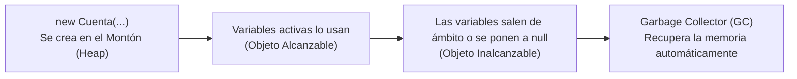

# 📘 Tema 2: Visibilidad, Memoria, Garbage Collector y Tipos de Métodos

> **Correspondencia con el Manual Oficial UF2404:** Páginas 12 a 17.  
> **Objetivo:** Dominar los 4 niveles de visibilidad de Java, el ciclo de vida de los objetos en memoria RAM, cómo funciona el recolector de basura y cómo clasificar formalmente cualquier método.

---

## 🔒 1. Los 4 Niveles de Visibilidad en Java

En Java no solo existen `public` y `private`. Hay **cuatro niveles de acceso**:

| Modificador | ¿Quién puede verlo? | ¿Para qué se usa habitualmente? |
| :--- | :--- | :--- |
| **`public`** | **Cualquier clase** de todo el proyecto. | Métodos del menú, interfaces y constructores que deben poder usarse desde fuera. |
| **`protected`** | El **mismo paquete** y todas sus **clases hijas (subclases)** aunque estén en otro paquete. | Atributos compartidos en herencia (como `protected int dentro` en `Vehiculos`). |
| *(Por defecto / sin palabra)* <br/>*(Package-Private)* | **Solo las clases del mismo paquete**. Clases de otros paquetes o hijas fuera no lo ven. | Clases auxiliares o herramientas internas de un módulo. |
| **`private`** | **Únicamente la propia clase**. Nadie más. | Atributos internos (`saldo`, `color`, listas) para garantizar el encapsulamiento. |

> ⚠️ **Regla de Encapsulamiento:** Oculta siempre lo máximo posible: **Atributos privados** y expón únicamente los métodos necesarios como públicos.

---

## 🧠 2. Ciclo de Vida del Objeto y el Recolector de Basura (*Garbage Collector*)

En lenguajes antiguos como C o C++, el programador tenía que reservar memoria con `malloc()` y liberarla a mano con `free()`. Si olvidabas un `free()`, el programa devoraba la memoria RAM del ordenador.



### ¿Cómo funciona en Java?
1. **Creación:** Con `new Cuenta(...)` se reserva espacio en la zona de memoria llamada **Montón (Heap)**.
2. **Vida:** Mientras alguna variable viva (en la pila / *Stack*) tenga su dirección de memoria, el objeto existe.
3. **Muerte automática:** Cuando ninguna variable apunta a él (por ejemplo, la variable era local de un método que ya terminó, o pusiste `objeto = null;`), el objeto se convierte en **inalcanzable**.
4. **Recogida:** El **Garbage Collector** pasa en segundo plano cuando el sistema lo necesita y limpia esa memoria automáticamente.

### ¿Hay fugas de memoria en Java?
¡Sí! Se llaman **Fugas Lógicas de Memoria**. Ocurren cuando guardas objetos en listas estáticas (`static List<...>`): como la lista estática nunca muere mientras el programa esté abierto, los objetos que metes dentro jamás son recogidos por el Garbage Collector, llenando la memoria poco a poco.

---

## 🚪 3. Liberación de Recursos Externos: `AutoCloseable` y `try-with-resources`

El Garbage Collector libera la memoria RAM, pero **NO puede cerrar ficheros de disco, bases de datos o conexiones de red**.

Para cerrar esos recursos de forma 100% segura sin olvidar hacerlo, Java inventó la interfaz `AutoCloseable` y la estructura **`try-with-resources`**:

```java
// Al poner el recurso dentro de los paréntesis del try:
try (Scanner sc = new Scanner(System.in)) {
    // Código de lectura...
} // ¡Al llegar aquí, Java llama automáticamente a sc.close() sin que tengas que acordarte!
```

---

## 🔗 4. La Referencia `this`: Atributo, Encadenamiento y Fluent API

La palabra `this` tiene 3 usos esenciales en Java:

### 1. Desambiguar atributo de parámetro:
```java
public void setSaldo(double saldo) {
    this.saldo = saldo; // this.saldo es el atributo; saldo es el dato que llegó
}
```

### 2. Encadenar constructores (`this(...)`):
```java
public Cuenta(String titular) {
    this(titular, 0.0); // Llama al constructor de 2 parámetros
}
```

### 3. Devolver la propia instancia para encadenar llamadas (*Fluent API*):
```java
public class Punto {
    private int x;
    public Punto sumar(int n) {
        this.x += n;
        return this; // Devuelve el propio objeto
    }
}

// Permite encadenar órdenes en una sola línea:
Punto p = new Punto();
p.sumar(5).sumar(10).sumar(2); // ¡Punto vale 17!
```

---

## 📋 5. Clasificación Formal de Métodos según su Función

En los exámenes de certificación del módulo MF0227_3, los métodos se clasifican formalmente en 5 categorías:

| Categoría | Propósito técnico | Ejemplo en nuestro código |
| :--- | :--- | :--- |
| **Constructor** | Reserva memoria e inicializa los atributos en un estado válido. | `public Coches(int limite)` |
| **Consulta (*Getter*)** | Lee información del estado del objeto sin modificarlo. | `public int cuantosHay()` |
| **Modificador (*Setter* / Comando)** | Altera el estado del objeto aplicando reglas y validaciones. | `public void entrar()`, `setLed(...)` |
| **Utilidad** | Realiza conversiones o cálculos auxiliares. | `@Override public String toString()` |
| **Destrucción / Cierre** | Libera recursos externos (archivos, sockets, conexiones). | `public void close()` |

---

## 📐 6. Representación UML Oficial de una Clase

En los diagramas de clases UML, cada clase se dibuja con una caja dividida en **3 compartimentos**:

```
+------------------------------------------+
|                 Cuenta                   |  <-- Compartimento 1: Nombre
+------------------------------------------+
| - titular: String                        |  <-- Compartimento 2: Atributos
| - saldo: double                          |      - = private
| - totalCuentas: int {static}             |      + = public
+------------------------------------------+      # = protected
| + ingresar(importe: double): void        |  <-- Compartimento 3: Métodos
| + retirar(importe: double): void         |
| + getSaldo(): double                     |
| + toString(): String                     |
+------------------------------------------+
```
*(Nota: los miembros estáticos `static` se indican en UML con la etiqueta `{static}` o subrayando el texto).*
