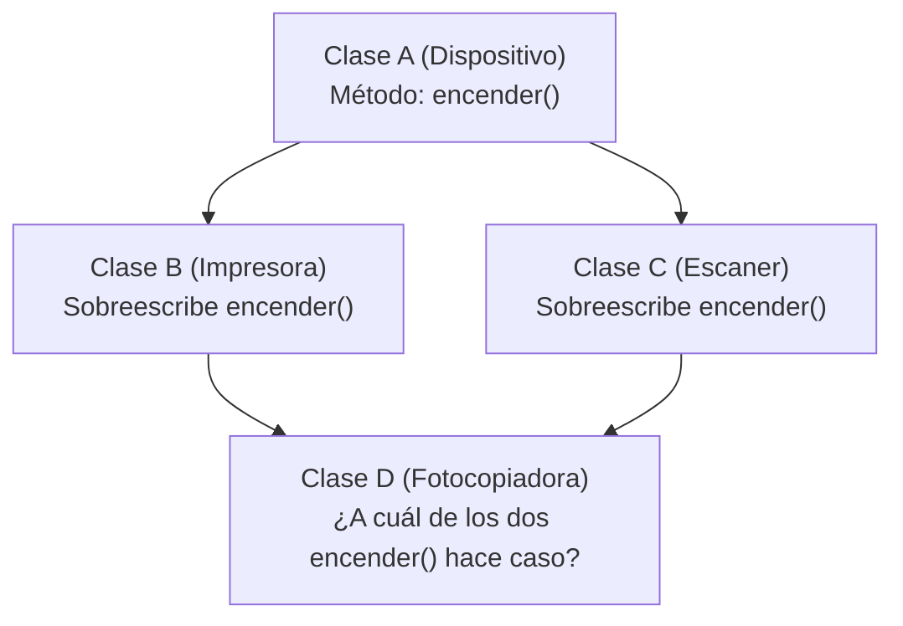

# 📘 Tema 3: Herencia Avanzada, la Clase Raíz `Object` y el Problema del Diamante

> **Correspondencia con el Manual Oficial UF2404:** Páginas 18 a 22.  
> **Objetivo:** Comprender las reglas estrictas de la herencia en Java, los métodos universales de `java.lang.Object`, por qué está prohibida la herencia múltiple de clases y el Principio de Liskov.

---

## 🧬 1. Las Reglas Estrictas de la Herencia en Java

Cuando usamos la palabra reservada `extends`:

1. **La prueba del "Es-Un":** Antes de heredar, pregúntate: ¿La clase B **es un** tipo específico de A?  
   * ¿Un `Coche` es un `Vehiculo`? **Sí** (Herencia correcta).
   * ¿Un `Pedido` es una `ListaDeLineas`? **No**, un pedido *tiene* una lista de líneas (Usa Composición, no herencia).
2. **`super(...)` debe ser la PRIMERA instrucción:**  
   En el constructor de la clase hija, no puedes poner ninguna línea antes de llamar a `super(...)`:
   ```java
   public Coches(int limite) {
       super("Coche", limite); // ¡TIENE que ser la línea 1 obligatoriamente!
       this.puertas = 5;
   }
   ```
3. **Los constructores NO se heredan:** Las clases hijas heredan los atributos y los métodos de su padre, pero **jamás sus constructores**. Cada subclase debe escribir sus propios constructores e invocar al padre con `super(...)`.

---

## 🌳 2. La Clase Raíz del Universo Java: `java.lang.Object`

En Java, absolutamente **todas las clases** que creas heredan directa o indirectamente de la clase universal `java.lang.Object`, aunque no escribas la palabra `extends`.

Por esta razón, cualquier objeto de Java ya viene con 4 métodos heredados de fábrica:

| Método de `Object` | ¿Para qué sirve? | ¿Cuándo conviene sobreescribirlo (`@Override`)? |
| :--- | :--- | :--- |
| **`toString()`** | Devuelve una representación legible en texto del objeto. | **Casi siempre**, para que al hacer `System.out.println(objeto)` no salga un código raro como `Coches@7a811`. |
| **`equals(Object obj)`** | Compara si dos objetos tienen el mismo **contenido** lógico. | Cuando dos objetos en memoria RAM distinta deban considerarse iguales si tienen el mismo DNI, matrícula o código. |
| **`hashCode()`** | Devuelve un número entero identificativo para colecciones rápidas (`HashSet`, `HashMap`). | **Siempre que sobreescribas `equals`**. *(Regla sagrada de Java: si dos objetos son iguales con `equals`, deben tener el mismo `hashCode`)*. |
| **`getClass()`** | Devuelve la clase real en tiempo de ejecución. | Para inspección y reflexión. **No se puede sobreescribir** (es `final`). |

---

## 💎 3. El Problema del Diamante y la Herencia Múltiple

¿Por qué en Java no podemos escribir `class Coche extends Vehiculo, Maquina`?

Porque introduce la ambigüedad fatal conocida como **El Problema del Diamante**:



Si la clase `B` y la clase `C` modifican el método `encender()`, y luego la clase `D` intenta heredar de ambas... **¿cuál de los dos métodos debería ejecutar `D`?**

### La solución de los creadores de Java:
Para evitar este dolor de cabeza:
* **Java PROHÍBE la herencia múltiple de clases** (solo puedes poner un `extends`).
* En su lugar, Java utiliza **Interfaces**: una clase puede implementar múltiples interfaces (`implements Volador, Nadador`).

---

## 🧱 4. Clases y Métodos `final`: Bloqueando la Herencia

Si quieres proteger una clase para que nadie pueda heredar de ella o modificar sus métodos:

* **Método `final`:** Las subclases pueden usarlo, pero **no pueden sobreescribirlo** con `@Override`.
  ```java
  public final void metodoSeguro() { ... }
  ```
* **Clase `final`:** Nadie en todo el proyecto puede hacer `extends` de ella (queda cerrada).
  ```java
  public final class SeguridadBancaria { ... }
  ```
  *(Por ejemplo, en Java la clase `String` y la clase `Math` son `final` por motivos de seguridad).*

---

## 🚫 5. Cuándo NO Usar Herencia (El Principio de Sustitución de Liskov)

La herencia crea un acoplamiento muy fuerte entre clases. El manual oficial recomienda **evitar la herencia** en estos 3 casos:

1. **Cuando no se cumple "Es-Un":** Si una clase solo quiere copiar 1 método de otra, no heredes; utiliza agregación o composición.
2. **Jerarquías demasiado profundas:** Si tienes más de 3 o 4 niveles (`A -> B -> C -> D -> E`), el código se vuelve frágil e incomprensible.
3. **Violación del Principio de Liskov (LSP):** Si la subclase necesita desactivar o lanzar errores en los métodos que heredó del padre porque "a ella no le aplican" (ejemplo: un `Pinguino` que hereda de `Ave` y en `volar()` lanza una excepción porque no vuela).

> 💡 **Consejo de Arquitectura:** *"Favorece la composición sobre la herencia"* (*Composition over inheritance*).
