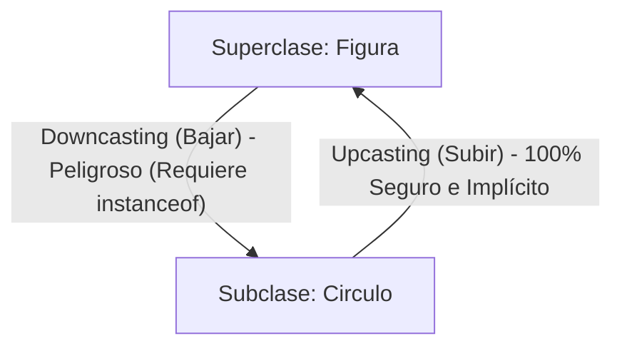

# 📘 Tema 5: Polimorfismo, Clases Abstractas, Interfaces y Casting Seguro

> **Correspondencia con el Manual Oficial UF2404:** Páginas 28 a 32.  
> **Objetivo:** Comprender las 4 formas de polimorfismo, la diferencia definitiva entre clases abstractas e interfaces, y cómo transformar tipos de forma segura con `instanceof`.

---

## 🎭 1. ¿Qué es el Polimorfismo?

Polimorfismo viene del griego: **"Muchas formas"**.  
Significa que **un mismo mensaje** produce **comportamientos distintos** según el tipo real del objeto que lo reciba.

* Si tienes una lista de animales: `perro`, `gato`, `vaca`.
* A todos les envías el mismo mensaje: `hacerSonido()`.
* El código no necesita saber qué animal es: cada uno responde a su manera (el perro ladra, el gato maúlla, la vaca muge).

### El Principio Abierto/Cerrado (OCP):
El polimorfismo te permite **añadir nuevas clases sin modificar el código que ya funciona**. Si mañana añades la clase `Pato`, el bucle que hace sonar a los animales funciona sin tocarle ni una sola coma.

---

## 📑 2. Los 4 Tipos Formales de Polimorfismo

En el temario oficial se definen cuatro maneras distintas de aplicar polimorfismo:

| Tipo de Polimorfismo | ¿Cómo se consigue? | ¿Cuándo se resuelve? | Ejemplo en código Java |
| :--- | :--- | :---: | :--- |
| **1. Sobrecarga (*Ad hoc*)** | Mismo nombre de método con distintos parámetros en una clase. | **En compilación** | `sumar(int a, int b)`<br/>`sumar(double a, double b)` |
| **2. Sobreescritura (*Subtipos*)** | La subclase redefine un método de su padre con `@Override`. | **En ejecución** (Enlace Dinámico) | `area()` en `Circulo` vs `Rectangulo` |
| **3. Por Interfaz** | Clases sin ningún parentesco familiar cumplen el mismo contrato. | **En ejecución** | `implements Comparable`, `implements Imprimible` |
| **4. Paramétrico (*Genéricos*)** | Escribes código aplicable a cualquier tipo de dato usando `<T>`. | **En compilación** | `List<T>`, `ArrayList<String>` |

---

## ⚖️ 3. Tabla Definitiva: Clase Abstracta vs Interfaz

Esta es una de las preguntas fijas en cualquier examen de POO:

| Característica | Clase Abstracta (`abstract class`) | Interfaz (`interface`) |
| :--- | :--- | :--- |
| **Atributos con estado** | ✅ Sí puede tener atributos normales (`saldo`, `color`). | ❌ No tiene atributos de estado (solo constantes `static final`). |
| **Herencia múltiple** | ❌ No (una clase solo puede heredar de una). | ✅ **Sí** (una clase puede implementar 10 interfaces). |
| **Métodos con código** | ✅ Sí, puede mezclar métodos abstractos con métodos terminados. | ✅ Desde Java 8 solo permite métodos `default` y `static`. |
| **Relación que expresa** | **"Es-Un"** (Jerarquía de familia). | **"Sabe-Hacer"** (Habilidad o capacidad). |
| **Instanciación con `new`** | ❌ Imposible (`new Figura()` da error). | ❌ Imposible. |
| **Cuándo usarla** | Cuando varias clases hermanas comparten código y estado común. | Para establecer contratos comunes entre clases totalmente dispares. |

---

## 🔄 4. Conversión de Tipos: *Upcasting* vs *Downcasting*



### 1. Upcasting (Subir a la superclase):
Tratas a un objeto especializado como si fuera de su tipo general:
```java
Figura f = new Circulo(5.0); // Upcasting: siempre es válido y seguro
```

### 2. Downcasting (Bajar a la subclase):
Intentas tratar a una referencia general como su tipo específico para acceder a métodos exclusivos de esa subclase (por ejemplo, `getRadio()`):
```java
// ❌ PELIGRO: Si 'f' no fuera un círculo, lanza ClassCastException y revienta el programa
Circulo c = (Circulo) f; 
```

### 3. La Solución Moderna: Pattern Matching para `instanceof` (Java 16+)
En versiones antiguas de Java tenías que comprobar y luego hacer el cast a mano.  
En Java moderno se comprueba y se convierte en una sola línea elegante:

```java
// Comprueba si 'f' es un Circulo y automáticamente crea la variable 'c' ya convertida
if (f instanceof Circulo c) {
    System.out.println("El radio es: " + c.getRadio());
} else {
    System.out.println("No es un círculo");
}
```

---

## 📐 5. Notación UML para Interfaces y Realización

* Una interfaz se representa en UML como una caja con el estereotipo `<<interface>>`.
* La relación entre una clase y la interfaz que implementa se llama **Realización**:
  * Se dibuja como una **línea discontinua con un triángulo hueco blanco** apuntando a la interfaz.

```
+-------------------+
|   <<interface>>   |
|      Volador      |
+-------------------+
| + volar(): void   |
+-------------------+
          ^
          :  (Línea discontinua con triángulo hueco)
          :
+-------------------+
|       Avion       |
+-------------------+
```
