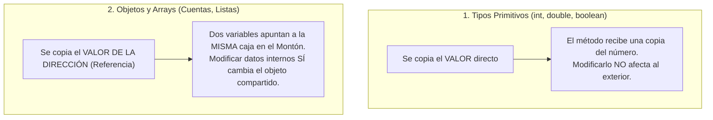

# 📘 Tema 6: Paso de Parámetros, Recursividad y Programación Estructurada en POO

> **Correspondencia con el Manual Oficial UF2404:** Páginas 33 a 36.  
> **Objetivo:** Comprender cómo se comunican las funciones por dentro, la regla sagrada del "paso por valor" en Java, cómo funciona la pila en la recursividad y cómo refactorizar código largo.

---

## 🏛️ 1. El Teorema de Böhm-Jacopini: Por qué ya no existe el `goto`

En los años 60, los programas saltaban de una línea a otra usando instrucciones desordenadas llamadas `goto` (el temido "código espagueti").

En 1966, los matemáticos Böhm y Jacopini demostraron que **cualquier algoritmo del universo** puede escribirse usando únicamente 3 estructuras:
1. **Secuencia:** Una instrucción tras otra en orden descendente.
2. **Selección (Decisión):** `if`, `else if`, `switch`.
3. **Repetición (Iteración):** `for`, `while`, `do-while`.

Y para que el programa sea legible, se aplica la **Descomposición Modular**: dividir problemas grandes en métodos pequeños.

---

## ⚠️ 2. Cuidado Clásico: La División Entera en Java

En Java, si divides dos números enteros, el resultado **SIEMPRE será un número entero truncado**, perdiendo los decimales:

```java
int a = 5;
int b = 2;

System.out.println(a / b);     // ❌ Imprime: 2 (se come el .5)
System.out.println(a / 2.0);   // ✅ Imprime: 2.5 (al haber un decimal, calcula en double)
```

---

## 📦 3. Vocabulario Formal de un Método

En la teoría de programación estructurada, cada elemento tiene un nombre técnico preciso:

```java
// FIRMA DEL MÉTODO (Nombre + tipos de parámetros): sumar(int, int)
public static int sumar(int a, int b) { // 'a' y 'b' son PARÁMETROS FORMALES
    int resultado = a + b;              // 'resultado' tiene ÁMBITO LOCAL (muere al salir del método)
    return resultado;                   // VALOR DEVUELTO (Función)
}

// EN OTRA PARTE DEL CÓDIGO:
int total = sumar(10, 20);              // 10 y 20 son los ARGUMENTOS REALES
```

* **Función:** Método que calcula algo y **devuelve un valor** con `return`.
* **Procedimiento:** Método que hace una acción en pantalla o estado y **no devuelve nada** (`void`).

---

## ⚡ 4. La Regla de Oro: En Java TODO es "Paso por Valor"

Esta es la pregunta trampa más habitual en entrevistas de trabajo técnicas:  
> *"¿Java pasa parámetros por valor o por referencia?"*  
> **Respuesta Oficial:** **En Java TODO se pasa por VALOR (se hace una copia).**

Pero hay un detalle crucial que debes entender:



### Demostración con código real:
```java
public static void modificar(int numero, int[] lista) {
    numero = 99;      // Solo cambia su copia local en la pila (Stack)
    lista[0] = 99;    // Modifica el objeto compartido en el montón (Heap)
}

public static void main(String[] args) {
    int n = 1;
    int[] v = { 1, 2, 3 };

    modificar(n, v);

    System.out.println(n);    // 👉 Sigue valiendo 1 (no cambió)
    System.out.println(v[0]); // 👉 Ahora vale 99 (el objeto fue modificado)
}
```

---

## 🪞 5. Recursividad: El Peligro del `StackOverflowError`

Un método es **recursivo** cuando se llama a sí mismo para resolver una versión más pequeña del mismo problema.

### Las 2 piezas obligatorias de todo algoritmo recursivo:
1. **Caso Base (Condición de parada):** Detiene la recursión para que no sea infinita.
2. **Paso Recursivo:** Vuelve a llamarse a sí mismo acercándose al caso base.

### Ejemplo: Factorial de un número ($5! = 5 \times 4 \times 3 \times 2 \times 1$):
```java
public static int factorial(int n) {
    if (n <= 1) { // 1. CASO BASE
        return 1;
    }
    return n * factorial(n - 1); // 2. PASO RECURSIVO
}
```

### ¿Qué pasa si olvidas el caso base?
Cada vez que un método se llama a sí mismo, el ordenador reserva un marco en la memoria de la **Pila (*Call Stack*)**.  
Si el método se llama miles de veces sin parar, llena la memoria y el programa se estrella con:  
💥 **`java.lang.StackOverflowError` (Desbordamiento de Pila)**.

> 💡 **Regla:** Cualquier problema recursivo puede resolverse siempre de forma iterativa mediante un bucle (`for` o `while`), consumiendo menos memoria.

---

## ✂️ 6. Refactorización y el Error *Off-by-One*

### 1. Métodos Privados Auxiliares:
Un buen método debe realizar **una sola tarea** y tener un tamaño que quepa en una pantalla sin hacer scroll.  
Si un método tiene 60 líneas, se debe **refactorizar** extrayendo trozos de código a **métodos privados auxiliares (`private`)**:
* El método `public` es la fachada que muestra el resultado.
* Los métodos `private` hacen los cálculos internos intermedios.

### 2. El Error *Off-by-One* (Error del Desfase en Uno):
Es el error más común al depurar: intentar recorrer un array de tamaño 10 desde el índice 1 hasta el 10, en lugar de ir **del 0 al 9**:
```java
int[] datos = new int[5]; // Plazas disponibles: 0, 1, 2, 3, 4

// ❌ ERROR OFF-BY-ONE (Lanza ArrayIndexOutOfBoundsException al llegar a 5)
for (int i = 0; i <= datos.length; i++) { ... }

// ✅ FORMA CORRECTA
for (int i = 0; i < datos.length; i++) { ... }
```
