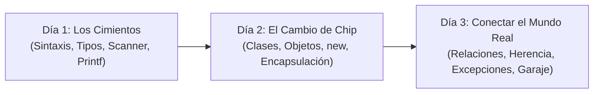

# 🎯 Visión General: ¿Qué Busca el Profe en estos 3 Primeros Días de Clase?

> **Archivo:** `00_vision_general_que_quiere_el_profe.md`  
> **Propósito:** Dar un paso atrás, ver la imagen completa y entender el camino pedagógico del profesor para que nunca sientas que vas "a ciegas".

---

## 🧭 Introducción: El Viaje de estos 3 Días

Aprender Java cuando vienes de Python o estás empezando es como cambiar de una bicicleta de paseo a los mandos de un avión comercial:
* En **Python**, escribes `print("hola")` y funciona. No te preocupas por tipos ni memoria.
* En **Java**, te obligan a declarar clases, métodos `main`, tipos de datos estrictos, llaves y puntos y comas.

El profesor **NO te está enseñando cosas sueltas al azar**. Durante estas 3 sesiones ha seguido un plan paso a paso diseñado para transformar tu mente de un "escribidor de código" a un **"diseñador de software orientado a objetos"**.

---

## 📅 El Hilo Conductor: Qué quería que aprendieras cada día

### 🟢 DÍA 1: "Aprender a hablar con la máquina en Java"
* **El objetivo del profesor:** Que te familiarices con las reglas básicas del lenguaje sin asustarte por la verbosidad de Java.
* **Las ideas clave que quería transmitirte:**
  1. En Java **nada vive suelto**: todo va dentro de una clase y arranca en el `public static void main`.
  2. La máquina necesita saber de antemano el tipo de dato de cada caja de memoria (`int`, `double`, `boolean`, `String`).
  3. Cómo meter datos del mundo exterior (`Scanner`) y cómo sacarlos bonitos y ordenados (`System.out.printf`).
  4. La importancia de la disciplina sintáctica: los bloques van entre llaves `{}` y cada orden termina obligatoriamente en `;`.
* **Ejercicios que respaldan esto:** `P1_ejemplo.java`, `P2_ejemplo.java`, `P3_ejemplo.java`.

---

### 🟡 DÍA 2: "El cambio de chip: Dejar de pensar en variables sueltas y pensar en Objetos"
* **El objetivo del profesor:** Que entiendas que los programas profesionales no son listas gigantescas de variables `saldo1`, `saldo2`, `nombre1`, `nombre2`.
* **Las ideas clave que quería transmitirte:**
  1. **La metáfora del molde:** Creas una clase (`Producto`, `Cuenta`) para que sirva de fábrica de objetos independientes.
  2. **¿Qué hace `new`?** Entender que `new` es la orden que va a la memoria RAM a fabricar físicamente el objeto.
  3. **Encapsulamiento (`private`):** Proteger el estado interno. El saldo o el stock no se pueden modificar a lo loco desde fuera; solo a través de métodos controlados (`vender()`, `ingresar()`).
  4. **Frenos de emergencia (`throw new IllegalArgumentException`):** Un objeto no puede nacer roto. Si te pasan un precio negativo o un stock inválido, el constructor debe rechazarlo en seco.
* **Ejercicios que respaldan esto:** `Producto` (patatas y peras en `p1_ej_bloques.java`) y `Cuenta` bancaria.

---

### 🔴 DÍA 3: "Arquitectura: Cómo se conectan los objetos y cómo reaccionan al fallo"
* **El objetivo del profesor:** Pasar de un objeto solitario a un **ecosistema de objetos colaborando entre sí**, tal como funciona cualquier aplicación real.
* **Las ideas clave que quería transmitirte:**
  1. **Relaciones entre clases:** 
     * *Asociación:* Un objeto conoce a otro (`Curso` conoce a su `Profesor`).
     * *Agregación:* Un todo agrupa partes que sobreviven solas (`Departamento` agrupa `Profesores`).
     * *Composición:* Partes que nacen y mueren con el contenedor (`Socio` con sus `Prestamos`).
  2. **Herencia y Polimorfismo:** No repetir código. Una clase base (`Empleado`) define lo común, y sus hijas (`EmpleadoFijo`, `Directivo`) especializan el cálculo con `@Override`.
  3. **Comprender los fallos en tiempo de ejecución:** Distinguir entre un error de sintaxis y una excepción lanzada por la lógica del negocio (lo que descubriste en `gestionDeCurso.java` con la fecha de baja).
  4. **Diseño extensible a futuro:** El ejercicio del **Garaje y el Semáforo LED**. Separar la lógica del garaje (aforo de 50 coches) del indicador visual (LED verde, naranja y rojo), conectándolos limpiamente para que el software pueda crecer mañana sin romperse hoy.
* **Ejercicios que respaldan esto:** `empleado.java`, `gestionDeCurso.java`, `ej.java` y `garaje.java`.

---

## 🎓 Conclusión: ¿Qué perfil estás construyendo?

El profesor no busca que memorices 500 líneas de memoria. Lo que busca evaluar y consolidar en ti es:

1. **Capacidad de modelar:** Leer un enunciado en español (*"Un garaje de 50 plazas con un LED a futuro"*) y ser capaz de extraer las clases, los atributos y los métodos necesarios.
2. **Sentido común de negocio:** Saber cuándo lanzar un error (`throw`) para proteger el sistema (no dejar entrar al coche 51, no permitir notas menores a 0).
3. **Lectura de código:** Abrir cualquier archivo `.java` de clase y saber decir:  
   * *"Este `new` reserva memoria."*
   * *"Este `this.` apunta al atributo de mi objeto."*
   * *"Este `private` protege mis variables."*
   * *"Este `extends` reutiliza al padre."*

---

## 📚 Índice de la Colección de Manuales Creados para Ti

Para afianzar cada concepto con código, esquemas visuales y comparaciones con Python, tienes los 4 manuales organizados en esta misma carpeta:

1. [**01_fundamentos_operadores_y_entrada_salida.md**](./01_fundamentos_operadores_y_entrada_salida.md): Diccionario de palabras clave en inglés, todos los operadores (`+`, `-`, `++`, `--`, `&&`, `||`), qué hace `println` vs `print` vs `printf`, y el uso de `Scanner`.
2. [**02_poo_clases_objetos_new_this_y_encapsulacion.md**](./02_poo_clases_objetos_new_this_y_encapsulacion.md): Por qué se escribe cada línea, qué hace `new`, qué hace `this`, por qué usamos `private` y el desglose línea a línea de `Producto`.
3. [**03_relaciones_entre_clases_y_control_de_excepciones.md**](./03_relaciones_entre_clases_y_control_de_excepciones.md): Asociación, Agregación, Composición, listas `ArrayList`, qué hace `throw`, qué hacen `try-catch`, y la lección del fallo de `gestionDeCurso.java`.
4. [**04_herencia_polimorfismo_static_y_casos_reales.md**](./04_herencia_polimorfismo_static_y_casos_reales.md): Qué hace `static`, qué hace `super`, `@Override`, y el desglose de `empleado.java` y `garaje.java` con su semáforo LED.
