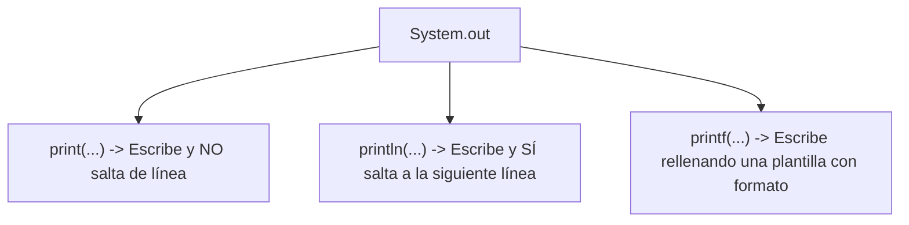

# 📘 Manual 1: Fundamentos, Todos los Operadores, Entrada/Salida y Diccionario

> **Carpeta de referencia:** `TeoriaExplicadaPor-IA/01_fundamentos_operadores_y_entrada_salida.md`  
> **Para qué sirve:** Tener a mano la explicación de cada palabra rara, cada símbolo y cada operador en Java, con su traducción del inglés y su comparación con Python.

---

## 🔤 1. Diccionario de Términos Clave (Inglés ➔ Español ➔ Qué hace)

| Palabra en Java | Significado en Inglés | ¿Qué hace en tu código? |
| :--- | :--- | :--- |
| **`public`** | Público | Accesible desde cualquier parte de tu proyecto sin restricciones. |
| **`class`** | Clase / Categoría | El molde o plantilla donde defines los datos y las acciones. |
| **`static`** | Estático / Fijo | Pertenece a la **clase en general**, no a un objeto concreto. Se puede usar sin crear objetos con `new`. |
| **`void`** | Vacío | Significa que el método hace una acción pero **no devuelve ningún dato** (no lleva `return con valor`). |
| **`main`** | Principal | El punto de arranque obligatorio donde el ordenador empieza a leer tu programa. |
| **`String`** | Cadena (de texto) | Tipo de dato para almacenar texto entre comillas dobles `"hola"`. |
| **`args`** | Argumentos | Parámetros o datos extra que se le pueden pasar al programa al arrancarlo desde consola. |
| **`package`** | Paquete | La carpeta dentro de tu proyecto donde está guardado el archivo. |
| **`import`** | Importar | Traer herramientas que ya vienen hechas en Java (como `Scanner`, `List`, `ArrayList`). |
| **`new`** | Nuevo | **Pide memoria al ordenador** y fabrica un objeto nuevo a partir de una clase. |

---

## 📺 2. ¿Qué hace `println` y en qué se diferencia de los demás?

En Java no existe `print` suelto como en Python. Para sacar texto por la pantalla usamos la salida del sistema: `System.out`.

```
System (El Sistema) ➔ out (Salida estándar / Pantalla) ➔ println (Acción de imprimir)
```

### Las 3 formas de imprimir en consola:



### 1. `System.out.println("Texto")`
* **¿Qué hace?** Muestra el mensaje y **añade automáticamente un salto de línea al final** (*ln = line*). El siguiente mensaje se imprimirá en el renglón de abajo.
* **Ejemplo:**
  ```java
  System.out.println("Línea 1");
  System.out.println("Línea 2");
  // Salida:
  // Línea 1
  // Línea 2
  ```

### 2. `System.out.print("Texto")`
* **¿Qué hace?** Muestra el mensaje pero **deja el cursor pegado al final**, en el mismo renglón.
* **¿Para qué se usa?** Es perfecto para hacer preguntas al usuario antes de que escriba:
  ```java
  System.out.print("Introduce tu nombre: "); // El usuario escribe justo al lado
  ```

### 3. `System.out.printf("Formato", variables)`
* **¿Qué hace?** Imprime con formato sustituyendo marcadores (`%`).
  * `%s` = Texto (`String`).
  * `%d` = Número entero (`int`).
  * `%.2f` = Decimal (`double`) cortado a 2 decimales.
  * `%n` = Salto de línea dentro del formato.
  * `%%` = Imprime el símbolo de porcentaje `%` literal sin romper el código.

#### 📐 El Secreto de las Columnas y Alineación en Tablas/Facturas:
Cuando quieres que el texto y los números salgan alineados en columnas rectas (como un ticket de supermercado o una tabla), se le añade un **número de ancho** al marcador:

| Marcador | ¿Qué hace con los espacios? | Alineación | Ejemplo |
| :--- | :--- | :---: | :--- |
| **`%-20s`** | Reserva **20 huecos** para el texto. El signo menos `-` empuja el texto a la **izquierda** y rellena con espacios a la derecha. | ⬅️ Izquierda | `[Subtotal:           ]` |
| **`%10.2f`** | Reserva **10 huecos** para el número. Al ser positivo, empuja el número a la **derecha** y rellena con espacios a la izquierda. | ➡️ Derecha | `[     54.00]` |

* **Ejemplo de factura con 2 columnas perfectas:**
  ```java
  System.out.printf("%-20s %10.2f EUR%n", "Subtotal:", 90.0);
  System.out.printf("%-20s %10.2f EUR%n", "IVA (21%):", 18.90);
  System.out.printf("%-20s %10.2f EUR%n", "Descuento:", 4.50);
  // Salida perfectamente alineada:
  // Subtotal:                 90.00 EUR
  // IVA (21%):                18.90 EUR
  // Descuento:                 4.50 EUR
  ```

---

## 🧮 3. TODOS los Operadores de Java Explicados uno a uno

### A) Operadores Aritméticos (Cálculos matemáticos)

| Operador | Nombre | Qué hace | Ejemplo en código | Resultado |
| :---: | :--- | :--- | :--- | :--- |
| `+` | Suma | Suma números o junta textos (concatena) | `5 + 3` / `"Hola " + "Juan"` | `8` / `"Hola Juan"` |
| `-` | Resta | Resta el segundo valor del primero | `10 - 4` | `6` |
| `*` | Multiplicación | Multiplica valores | `4 * 3` | `12` |
| `/` | División | Divide (si son enteros no da decimales) | `10 / 2` / `7 / 2` | `5` / `3` (entero) |
| `%` | Módulo (Resto) | Devuelve el sobrante de una división | `10 % 3` | `1` (porque 3x3=9, sobra 1) |

---

### B) Operadores de Incremento y Decremento (`++` y `--`)
Son atajos para sumar o restar 1 a una variable numérica:

| Operador | Qué significa | Equivalencia larga | Cuándo lo usamos en tus clases |
| :---: | :--- | :--- | :--- |
| **`++`** | Sumar 1 | `variable = variable + 1;` | Cuando entra un coche al garaje: `cochesDentro++;` |
| **`--`** | Restar 1 | `variable = variable - 1;` | Cuando sale un coche del garaje: `cochesDentro--;` |

---

### C) Operadores de Asignación Compuesta (`+=`, `-=`, etc.)

| Operador | Qué hace | Equivalencia | Ejemplo real |
| :---: | :--- | :--- | :--- |
| `+=` | Suma y guarda el resultado | `a = a + b;` | `saldo += importe;` (añadir dinero a la cuenta) |
| `-=` | Resta y guarda el resultado | `a = a - b;` | `stock -= unidades;` (restar productos vendidos) |
| `*=` | Multiplica y guarda | `a = a * b;` | `total *= 1.21;` (aplicar IVA) |

---

### D) Operadores Relacionales (Comparaciones ➔ devuelven `true` o `false`)

| Operador | Significado | ¿Para qué sirve? | Ejemplo |
| :---: | :--- | :--- | :--- |
| `==` | ¿Es exactamente igual a? | Compara números o booleanos | `if (cochesDentro == 50)` |
| `!=` | ¿Es diferente de? | Comprueba desigualdad | `if (fechaBaja != null)` |
| `<` | Menor que | Límites inferiores | `if (coches < 25)` (LED Verde) |
| `<=` | Menor o igual que | Incluye el tope | `if (nota <= 4.9)` (Suspenso) |
| `>` | Mayor que | Límites superiores | `if (unidades > stock)` |
| `>=` | Mayor o igual que | Incluye el tope | `if (nota >= 5.0)` (Aprobado) |

> ⚠️ **¡PELIGRO EN JAVA!**  
> Para comparar textos (`String`) **NUNCA uses `==`**.  
> Usa siempre `.equals()`.  
> * Mal: `if (color == "ROJO")` ❌  
> * Bien: `if (color.equals("ROJO"))` o `if (color.equalsIgnoreCase("rojo"))` ✅

---

### E) Operadores Lógicos (Combinar condiciones)

| Operador | Nombre | Regla de oro | Ejemplo en tus ejercicios |
| :---: | :--- | :--- | :--- |
| **`&&`** | Y lógico (*AND*) | Da `true` **solo si las DOS cosas son verdaderas** | `if (coches >= 25 && coches < 50)` |
| **`\|\|`** | O lógico (*OR*) | Da `true` **con que UNA de las dos sea verdadera** | `if (nombre == null \|\| nombre.isEmpty())` |
| **`!`** | Negación (*NOT*) | Invierte el valor (lo verdadero pasa a falso) | `if (!estaLleno())` |

---

## ⌨️ 4. Entrada de Datos con `Scanner` y el Salto del Buffer

Para leer del teclado importamos la herramienta `java.util.Scanner`:

```java
import java.util.Scanner;

Scanner sc = new Scanner(System.in); // Creamos el lector
```

### Métodos de lectura del Scanner:
* `sc.nextLine()`: Lee **toda la frase** que escribas hasta que pulsas `Enter` (devuelve `String`).
* `sc.nextInt()`: Lee un número entero (`int`).
* `sc.nextDouble()`: Lee un número decimal (`double`).
* `sc.nextBoolean()`: Lee `true` o `false`.

### ⚠️ El error del "Salto Fantasma" (Buffer de teclado)
Si lees primero un número y luego un texto, el texto "se lo come" sin dejarte escribir:

```java
System.out.print("Dime tu edad: ");
int edad = sc.nextInt(); // Lees el número, pero el ENTER que pulsaste queda flotando en el buffer

sc.nextLine(); // 🧹 SOLUCIÓN: Esta línea vacía "traga" el Enter sobrante y limpia el buffer

System.out.print("Dime tu nombre: ");
String nombre = sc.nextLine(); // Ahora sí espera a que escribas
```

---

## 🐍 Comparación Rápida: De Python a Java

```python
# EN PYTHON:
edad = int(input("Dime tu edad: "))
if edad >= 18:
    print(f"Eres mayor de edad con {edad} años")
else:
    print("Menor")
```

```java
// EN JAVA:
import java.util.Scanner;

public class Comparacion {
    public static void main(String[] args) {
        Scanner sc = new Scanner(System.in);
        System.out.print("Dime tu edad: ");
        int edad = sc.nextInt();

        if (edad >= 18) {
            System.out.println("Eres mayor de edad con " + edad + " años");
        } else {
            System.out.println("Menor");
        }
        sc.close();
    }
}
```
