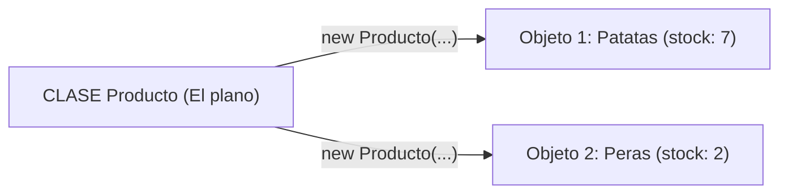

# 📘 Manual 2: POO al Detalle (¿Por qué se pone cada línea? `new`, `this`, `private` y Constructores)

> **Carpeta de referencia:** `TeoriaExplicadaPor-IA/02_poo_clases_objetos_new_this_y_encapsulacion.md`  
> **Objetivo:** Cuando mires cualquier clase en Java, sepas decir exactamente: *"Ah, esta línea está aquí por esta razón, y si la quito pasa esto"*.

---

## 🎂 1. Clase vs Objeto: La metáfora definitiva

* **Una `Clase` (El Molde / Plano):** Es el archivo de texto en Java. No ocupa memoria en el ordenador. Solo dice: *"Si algún día creas una Cuenta Bancaria, tendrá un titular y un saldo, y sabrá ingresar y retirar dinero"*.
* **Un `Objeto` (La Tarta / La Casa fabricada):** Es lo que vive en la memoria RAM cuando el programa se ejecuta. Es una cuenta concreta: *"La cuenta de Gabriel con 500 €"*.



---

## ⚡ 2. ¿Qué hace exactamente la palabra `new`?

Cuando escribes en tu código:
```java
Cuenta miCuenta = new Cuenta("Gabriel", 500.0);
```

La palabra **`new`** hace 3 cosas críticas detrás de escena:
1. **Va a la memoria RAM** del ordenador y le pide: *"Oye, resérvame un hueco limpio para guardar un nuevo objeto de tipo Cuenta"*.
2. **Llama al Constructor** de la clase `Cuenta("Gabriel", 500.0)` para que rellene ese hueco con los datos iniciales.
3. **Devuelve la dirección de memoria** de ese hueco y la guarda en tu variable `miCuenta`.

> 💥 **¿Por qué está ahí?** Si no pones `new`, no existe el objeto en memoria. Tu variable valdría `null` (vacío) y si intentas hacer `miCuenta.ingresar(50)`, el programa explotará con el famoso error `NullPointerException`.

---

## 🎯 3. ¿Qué hace exactamente la palabra `this`?

En tus clases ves todo el tiempo cosas como:
```java
public Producto(String nombre, double precio) {
    this.nombre = nombre;
    this.precio = precio;
}
```

### ¿Por qué se pone `this.nombre = nombre`?
En esa línea hay **DOS variables con el mismo nombre**:
1. `nombre` (a secas): Es el dato que viene de fuera por el paréntesis del constructor (el parámetro).
2. `this.nombre`: Es la variable propia que pertenece al objeto (el atributo de la clase).

> 💡 **La regla de oro:** `this` significa **"DE ESTE OBJETO"**.  
> Le dice a Java: *"Copia el `nombre` que me pasaron por el parámetro y guárdalo en el atributo `nombre` **DE ESTE OBJETO**"*.

### ¿Qué pasa si quitas `this`?
Si escribes:
```java
nombre = nombre; // ❌ AMBIGÜEDAD TOTAL
```
Java se confunde, se copia a sí mismo el parámetro y el atributo del objeto se queda a `null` (vacío).

---

## 🔒 4. ¿Por qué ponemos `private` en los atributos? (Encapsulamiento)

En tus ejercicios siempre ves:
```java
private double saldo;
private int stock;
```

### ¿Por qué NO ponerlos `public`?
Imagina que `saldo` fuera `public`:
```java
// Código de un programador despistado o malintencionado:
cuenta.saldo = -50000; // 😱 ¡Te arruinó la cuenta directamente saltándose las reglas!
```
Nadie comprobó si se podía tener saldo negativo.

### ¿Para qué sirve `private`?
`private` le pone un candado a la variable: **NADIE de fuera puede tocarla directamente**.  
La única forma de modificar el saldo es llamando a tus métodos autorizados:
```java
cuenta.retirar(100); // ✅ Este método sí comprueba si tienes dinero suficiente antes de restar
```

---

## 🛡️ 5. Los Modificadores de Visibilidad explicados

| Modificador | ¿Quién lo puede ver? | Ejemplo de uso |
| :--- | :--- | :--- |
| **`private`** | **SOLO la propia clase.** Nadie más. | Atributos sensibles (`saldo`, `stock`, `cochesDentro`). |
| **`public`** | **Todo el mundo.** Cualquier clase del proyecto. | Métodos que ofreces al exterior (`entrarCoche()`, `getSaldo()`). |
| **`protected`** | La propia clase, las del **mismo paquete** y las **subclases hijas**. | Clases padre en herencia (`Vehiculo`, `Empleado`). |
| *(Por defecto)* | Solo las clases que están en la **misma carpeta**. | Clases secundarias dentro del mismo archivo. |

---

## 🏗️ 6. El Constructor: ¿Por qué no lleva `void` ni `return`?

```java
public Producto(String nombre, double precio, int stock) { ... }
```

* **¿Qué es?** Es el método especial de bienvenida que se ejecuta **una sola vez** al nacer el objeto con `new`.
* **Regla 1:** Se tiene que llamar **exactamente igual que la clase**.
* **Regla 2:** **NUNCA lleva tipo de retorno ni `void`**. Si le pones `void`, Java se cree que es un método normal y corriente y no lo usará como constructor.
* **¿Por qué validamos dentro del constructor?**  
  Para **evitar que nazcan objetos rotos o ilegales**. Si alguien intenta crear un `new Producto("Manzana", -5, -2)`, lanzamos una excepción antes de que el objeto llegue a existir en memoria.

---

## 🔍 7. Desglose Línea por Línea del Ejercicio `Producto` (`p1_ej_bloques.java`)

Veamos tu código real de clase y la razón exacta de cada línea:

```java
// LÍNEA 1: Definimos el molde del producto
class Producto {

    // LÍNEA 2-4: Atributos privados.
    // RAZÓN: Guardan el estado del producto (nombre, precio, stock).
    // Son private para que nadie pueda cambiar el stock desde fuera sin pasar por vender() o reponer().
    private String nombre;
    private double precio;
    private int stock;

    // LÍNEA 5: Constructor.
    // RAZÓN: Obliga a quien use esta clase a suministrar nombre, precio y stock inicial.
    public Producto(String nombre, double precio, int stock) {
        
        // LÍNEA 6-7: Control de precio.
        // RAZÓN: Si el precio es <= 0, es un dato absurdo en una tienda. Frenamos el programa inmediatamente.
        if (precio <= 0)
            throw new IllegalArgumentException("Precio negativo");

        // LÍNEA 8-9: Control de stock inicial.
        // RAZÓN: No puedes empezar con existencias negativas.
        if (stock <= 0)
            throw new IllegalArgumentException("Stock negativo");

        // LÍNEA 10-11: Control de nombre.
        // RAZÓN: Evita nombres nulos o cadenas en blanco ("   ").
        if (nombre == null || nombre.isBlank())
            throw new IllegalArgumentException("Nombre obligatorio");

        // LÍNEA 12-14: Asignaciones con 'this'.
        // RAZÓN: Guardamos los datos validados en los atributos del objeto creado.
        this.nombre = nombre;
        this.precio = precio;
        this.stock = stock;
    }

    // LÍNEA 15: Método vender.
    // RAZÓN: Devuelve un 'double' (el dinero recaudado = unidades * precio).
    double vender(int unidades) {
        // Validación: ¿Piden más de lo que tenemos?
        if (unidades > stock)
            throw new IllegalArgumentException("Stock insuficiente de: " + nombre);
        
        // Validación: ¿Intentan comprar 0 o negativo?
        if (unidades <= 0)
            throw new IllegalArgumentException("Unidades no validas");

        // Actualizamos el inventario: restamos las unidades vendidas
        stock -= unidades; // Equivalente a: stock = stock - unidades;

        // Devolvemos el total a cobrar
        return unidades * precio;
    }

    // LÍNEA 16: Método reponer.
    // RAZÓN: Es 'void' porque no devuelve dinero ni datos, solo añade cajas al almacén.
    void reponer(int unidades) {
        if (unidades <= 20)
            throw new IllegalArgumentException("Unidades no validas");

        if (unidades > 300)
            throw new IllegalArgumentException("Avisa a un supervisor");

        // Añadimos las nuevas unidades al stock existente
        stock += unidades;
    }

    // LÍNEA 17: Método toString().
    // RAZÓN: Le dice a Java cómo imprimirse cuando alguien haga System.out.println(producto).
    @Override
    public String toString() {
        return nombre + " (" + precio + " EUR, stock " + stock + ")";
    }
}
```

---

## 📌 Resumen Mental para No Bloquearte

Cuando vayas a crear una clase, pregúntate en este orden:
1. **¿Qué datos necesita recordar?** ➔ Ponlos arriba como `private tipo nombre;` (Atributos).
2. **¿Con qué datos debe nacer?** ➔ Ponlos en el `public NombreClase(...)` con `this.x = x;` (Constructor).
3. **¿Qué acciones sabe hacer?** ➔ Escribe métodos que devuelvan algo (`double`, `boolean`) o que solo hagan una acción (`void`).
