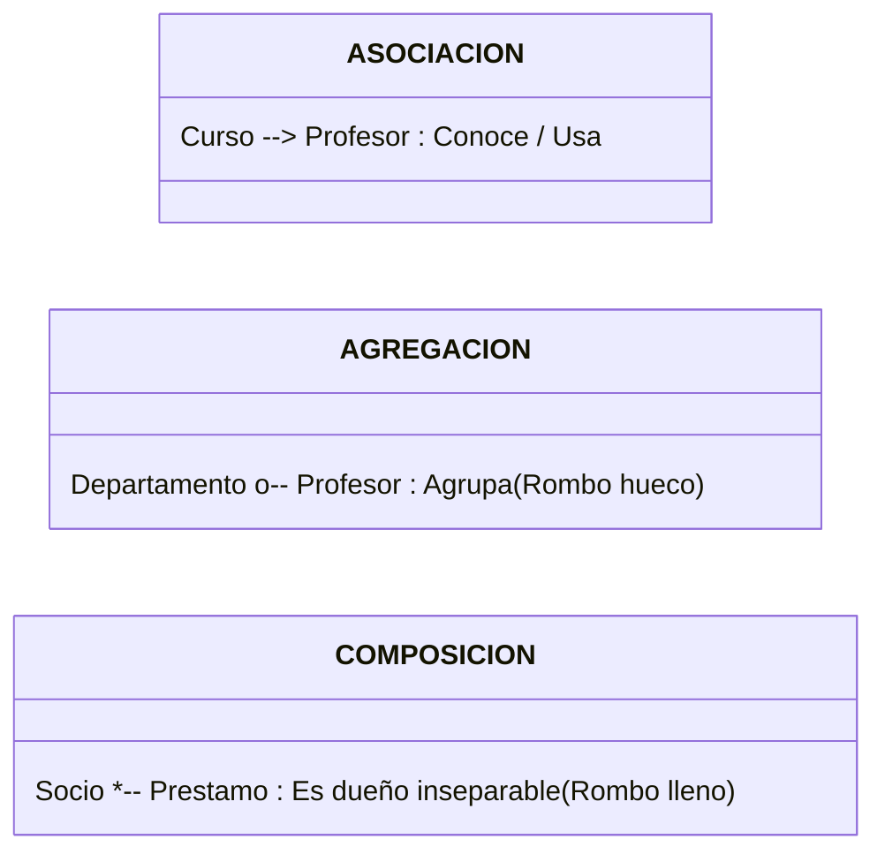
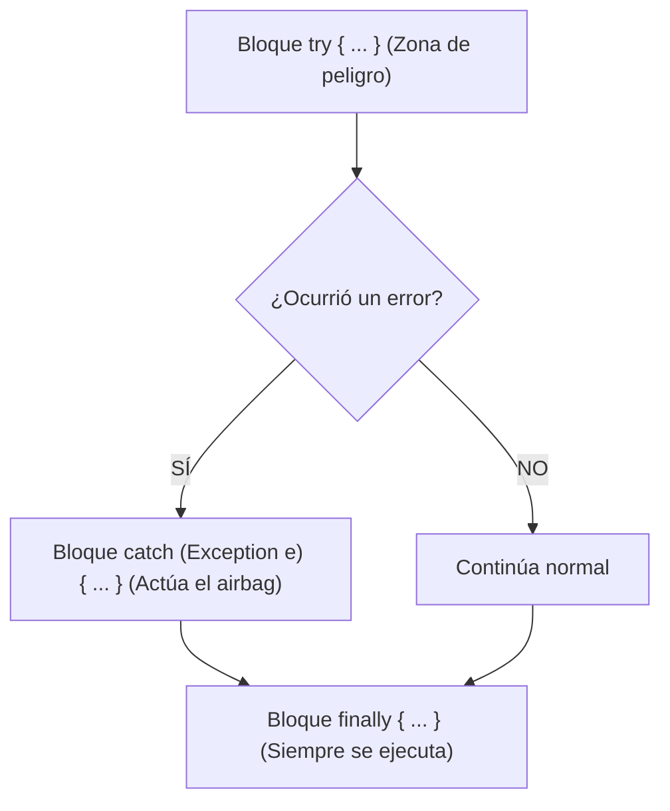

# 📘 Manual 3: Relaciones entre Clases, Colecciones y Manejo de Errores (`try-catch-throw`)

> **Carpeta de referencia:** `TeoriaExplicadaPor-IA/03_relaciones_entre_clases_y_control_de_excepciones.md`  
> **Objetivo:** Dominar cómo se conectan unas clases con otras (**Asociación, Agregación, Composición**) y entender de raíz el sistema de excepciones en Java para que nunca más te asustes con un error en consola.

---

## 🔗 1. Las 3 Formas en que se Relacionan las Clases

En el mundo real los objetos no viven aislados. Un curso tiene un profesor, un garaje tiene coches, un departamento tiene empleados.



---

### A) Asociación ("Usa a" o "Conoce a")
* **¿Qué es?** Es una relación simple donde un objeto guarda una referencia a otro para colaborar.
* **Ciclo de vida:** Totalmente independientes.
* **Ejemplo:** Un `Curso` tiene un atributo `Profesor tutor;`. El curso no es dueño del profesor, solo lo "conoce".

```java
class Curso {
    private String titulo;
    private Profesor tutor; // ASOCIACIÓN: Curso conoce a un Profesor

    public Curso(String titulo, Profesor tutor) {
        this.titulo = titulo;
        this.tutor = tutor;
    }
}
```

---

### B) Agregación ("Tiene un..." Débil)
* **¿Qué es?** Un objeto contenedor (el "todo") agrupa a varios objetos contenidos (las "partes").
* **Regla de oro del ciclo de vida:** **Las partes sobreviven si el contenedor desaparece**.
* **Ejemplo:** Un `Departamento` agrupa una lista de `Profesores`. Si la universidad cierra el departamento de Informática, los profesores **no mueren ni son borrados**, siguen existiendo en el instituto.

```java
import java.util.ArrayList;
import java.util.List;

class Departamento {
    private String nombre;
    private List<Profesor> profesores = new ArrayList<>(); // AGREGACIÓN

    public Departamento(String nombre) {
        this.nombre = nombre;
    }

    public void incorporar(Profesor p) {
        this.profesores.add(p);
    }
}
```

---

### C) Composición ("Parte inseparable" Fuerte)
* **¿Qué es?** Es la relación más íntima y estricta en programación.
* **Regla de oro del ciclo de vida:** **Las partes NO tienen sentido fuera del todo**. Si el objeto principal se destruye, sus partes se destruyen con él.
* **Ejemplo 1:** Un `Pedido` y sus `LineasDePedido`. Si anulas el pedido de compra, las líneas de ese pedido desaparecen.
* **Ejemplo 2:** Un `Socio` y su historial de `Prestamos` de biblioteca. Los préstamos pertenecen exclusivamente a la ficha de ese socio.

```java
class Socio {
    private String nombre;
    // COMPOSICIÓN: Los préstamos nacen y mueren ligados al socio
    private List<Prestamo> prestamos = new ArrayList<>(); 

    public Socio(String nombre) {
        this.nombre = nombre;
    }
}
```

---

## 🗃️ 2. ¿Qué son `List` y `ArrayList`? (Colecciones dinámicas)

En Python usas listas directamente: `alumnos = []` y haces `alumnos.append("Ana")`.  
En Java los arrays normales `int[]` tienen un tamaño fijo que no puede cambiar. Por eso usamos **`ArrayList`**:

```java
import java.util.ArrayList;
import java.util.List;

// Creamos una lista dinámica de textos (String)
List<String> matriculas = new ArrayList<>();

matriculas.add("1234-BBB");    // .add() -> Añade al final (como append en Python)
matriculas.add("5678-CCC");

int total = matriculas.size(); // .size() -> Te dice cuántos hay (como len() en Python)

boolean existe = matriculas.contains("1234-BBB"); // .contains() -> ¿Está dentro? true o false

matriculas.remove("1234-BBB"); // .remove() -> Elimina ese elemento de la lista
```

---

## 💥 3. ¿Qué es una Excepción y qué hace `throw`?

Una **excepción** es el **freno de emergencia** de un programa.

### ¿Qué hace `throw new ...`?
Cuando Java lee:
```java
throw new IllegalArgumentException("La nota debe estar entre 0 y 10");
```
Hace lo siguiente:
1. **Detiene la ejecución del método en seco** (no lee ni una sola línea más de ese bloque).
2. **Crea un objeto de error** con tu mensaje explicativo.
3. **Lanza el error hacia arriba** buscando si alguien lo captura con un `try-catch`. Si nadie lo captura, el programa finaliza y te muestra el error en rojo en la consola.

### Las dos excepciones que más vas a usar:
* **`IllegalArgumentException` (Argumento Ilegal):** Se usa cuando te pasan un dato de entrada que no tiene sentido (ej: un precio negativo, un nombre vacío, una nota de 14).
* **`IllegalStateException` (Estado Ilegal):** Se usa cuando la acción no se puede realizar por el estado actual del objeto (ej: intentar meter un coche cuando el garaje ya tiene 50 coches, o sacar dinero de una cuenta cancelada).

---

## 🛡️ 4. ¿Qué hacen `try`, `catch` y `finally`?

Son los "airbags" de tu aplicación. Evitan que el programa se caiga cuando salta un error.



### Ejemplo en código real:
```java
try {
    // 1. ZONA DE RIESGO: Código que podría fallar o tirar excepción
    garaje.entrarCoche(); // Imagina que el garaje ya estaba lleno a 50
    System.out.println("Coche aparcado con éxito.");

} catch (IllegalStateException e) {
    // 2. EL AIRBAG: Solo entra aquí si en el 'try' explotó esa excepción
    System.out.println("AVISO AL CONDUCTOR: " + e.getMessage());

} finally {
    // 3. SIEMPRE SE EJECUTA: Haya habido error o no (ideal para cerrar archivos o conexiones)
    System.out.println("Operación de barrera finalizada.");
}
```

---

## 🕵️‍♂️ 5. La Lección de Hoy: ¿Por qué te fallaron la línea 32 y 87 en `gestionDeCurso.java`?

Este fallo es el mejor ejemplo para entender cómo funciona Java:

### 1. El Constructor que tenías escrito:
```java
// Línea 31-33
if (fechaBaja == null || fechaBaja.isEmpty()) {
    throw new IllegalArgumentException("La fecha de baja no puede estar vacía"); // 💥 LÍNEA 32
}
```

### 2. La llamada en el `main`:
```java
// Línea 84
gestionDeCurso curso = new gestionDeCurso("Prof. Martínez", "ALUM1", "2024-11-03", "", 0.0);
curso.pedirDatos();

// Línea 87
System.out.println("=== Estado del Alumno ===");
```

### ¿Qué pasó de verdad?
1. **No era un fallo de compilación:** El código estaba bien escrito sintácticamente (puntos y comas en su sitio).
2. **Fue una Excepción en Ejecución:** En la línea 84 pasaste `""` como fecha de baja.
3. El constructor ejecutó el `if` de la línea 31 y **disparó el freno de emergencia (`throw`) en la línea 32**.
4. Como nadie tenía un `try-catch`, el programa murió en la línea 32. **Por eso jamás llegó a ejecutarse la línea 87**.
5. **La contradicción lógica:** Un alumno que se acaba de matricular **NO tiene fecha de baja**. Obligar a que la fecha de baja no estuviera vacía hacía imposible tener alumnos activos.

---

## 📌 Regla de Oro para Recordar

* Si el error te lo subraya VS Code en rojo antes de darle al Play: **Error de Compilación** (te falta un `;`, una llave `}` o escribiste mal una palabra).
* Si el programa arranca y luego sale texto rojo en consola con `Exception in thread "main"`: **Excepción en Ejecución** (un `throw` disparó el freno de mano por una condición que no se cumplió).
