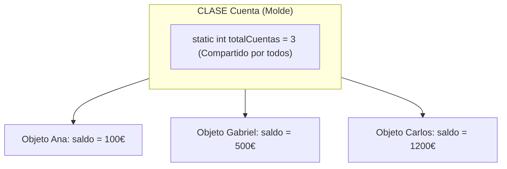
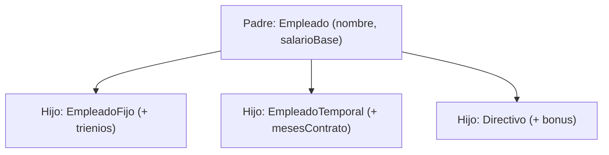

# 📘 Manual 4: Herencia, Polimorfismo, `static`, `super`, `@Override` y los Ejercicios Reales

> **Carpeta de referencia:** `TeoriaExplicadaPor-IA/04_herencia_polimorfismo_static_y_casos_reales.md`  
> **Objetivo:** Comprender las piezas más potentes de Java (**Herencia, Polimorfismo y Static**) viendo exactamente cómo están programados tus ejercicios reales de clase (`empleado.java`, `Cuenta` y `garaje.java` con el semáforo LED).

---

## 🏛️ 1. ¿Qué es `static`? (De Clase vs De Instancia)

Esta es una de las dudas más frecuentes en programación:

* **Variable de Instancia (Normal):** Cada objeto tiene su propia copia independiente.
  * Si creamos 3 cuentas: Ana tiene su saldo, Gabriel el suyo y Carlos el suyo.
* **Variable `static` (De Clase):** **Hay una única variable compartida para todos los objetos del mundo**. Pertenece a la clase entera.
  * Si la clase `Cuenta` tiene `private static int totalCuentas = 0;`, cada vez que alguien crea una cuenta con `new`, esa única variable suma `totalCuentas++`. Así el banco sabe cuántas cuentas existen en total.



### ¿Cómo se llama a algo `static`?
No necesitas un objeto. Se llama directamente con el **Nombre de la Clase**:
```java
int total = Cuenta.getTotalCuentas(); // Directo desde la clase
double raiz = Math.sqrt(25);          // Math.sqrt también es static
```

---

## 🔒 2. ¿Qué significa `final`?

* En una **variable**: Significa que es una **constante**. Una vez que le das un valor, **jamás se puede volver a cambiar**.
  ```java
  final String nombre = "Ana";
  nombre = "Carmen"; // ❌ ERROR DE COMPILACIÓN: no se puede reasignar
  ```
* En una constante global de clase se suele combinar:
  ```java
  public static final int CAPACIDAD_MAXIMA = 50; // Inmutable y compartida
  ```

---

## 🧬 3. Herencia: `extends` y `super`

Herencia significa crear una clase nueva (hija / subclase) aprovechando todo lo que ya tenía una clase existente (padre / superclase).

* **`extends` (Extiende / Hereda):** Le dice a Java: *"Copia todos los atributos y métodos del padre y déjame añadir mis cosas propias"*.
* **`super(...)` (Llama al padre):** Desde el constructor del hijo, **le pasa los datos comunes al constructor del padre**.
* **`super.metodo()`:** Ejecuta la versión original del método que tenía el padre.



---

## 🎭 4. Polimorfismo y `@Override`

* **Polimorfismo (Muchas Formas):** Significa poder tratar a distintos tipos de hijos como si fueran del mismo tipo padre, y **que cada uno responda a su manera**.
* **`@Override` (Sobreescribir):** Le avisa al compilador: *"Ojo, no uses el método del padre; voy a cambiar la fórmula por la mía propia"*.

---

## 💼 5. Caso Real 1: Desglose de `empleado.java`

Miremos el código que tienes en tu proyecto y por qué está escrita cada línea:

```java
// 1. CLASE PADRE (MOLDE GENERAL)
static class Empleado {
    // 'protected' para que sus hijas puedan ver estas variables
    // 'final' para que una vez contratado no le cambien el nombre sin querer
    protected final String nombre;
    protected final double salarioBase;

    Empleado(String nombre, double salarioBase) {
        this.nombre = nombre;
        this.salarioBase = salarioBase;
    }

    // Fórmula base para un empleado estándar
    double calcularNomina() {
        return salarioBase;
    }

    // Le dice a Java cómo presentarse en texto
    @Override
    public String toString() {
        // getClass().getSimpleName() devuelve el nombre de la clase real ("EmpleadoFijo", "Directivo", etc.)
        return getClass().getSimpleName() + " " + nombre;
    }
}

// 2. CLASE HIJA: EmpleadoFijo
// 'extends Empleado' hereda nombre y salarioBase automáticamente
static class EmpleadoFijo extends Empleado {
    private final int trienios; // Atributo único del fijo

    EmpleadoFijo(String nombre, double salarioBase, int trienios) {
        super(nombre, salarioBase); // 👈 Llama al constructor de Empleado para rellenar nombre y salario
        this.trienios = trienios;   // Guarda su atributo propio
    }

    // @Override: Cambia la fórmula general sumando 50€ por trienio
    @Override
    double calcularNomina() {
        return salarioBase + (50 * trienios);
    }
}

// 3. CLASE HIJA: Directivo
static class Directivo extends Empleado {
    private final double bonus;

    Directivo(String nombre, double salarioBase, double bonus) {
        super(nombre, salarioBase);
        this.bonus = bonus;
    }

    // @Override: El directivo suma su salario base más el bonus
    @Override
    double calcularNomina() {
        return salarioBase + bonus;
    }
}
```

### La magia del Polimorfismo en el `main`:
```java
// Creamos un array del padre (Empleado[]) pero guardamos hijos variados:
Empleado[] plantilla = {
    new EmpleadoFijo("Ana", 1200, 2),        // Cobrará 1200 + 100 = 1300€
    new EmpleadoTemporal("Luis", 900, 6),    // Cobrará 900€
    new Directivo("Carmen", 2000, 300)       // Cobrará 2000 + 300 = 2300€
};

// Con un solo bucle tratamos a todos por igual:
for (Empleado e : plantilla) {
    // Java sabe inteligentemente qué 'calcularNomina()' llamar según quién sea el objeto real
    System.out.println(e + " -> Nomina: " + e.calcularNomina() + " EUR");
}
```

---

## 🚗 6. Caso Real 2: El Garaje y el Semáforo LED (`garaje.java`)

Analicemos cómo resolvimos el ejercicio que te pidió el profesor paso a paso:

### ¿Qué se nos pidió?
1. Un garaje con control de coches dentro.
2. Tirar error si intenta entrar un coche cuando hay 50.
3. Contar salidas.
4. **Añadir a futuro un LED** que brille verde con plazas (< 25), naranja (25 a 49) y rojo si está lleno (50).

### ¿Por qué creamos la clase `SemaforoLed` separada?
Por el principio de **Responsabilidad Única**: Un garaje se encarga de abrir y cerrar barreras; una bombilla LED se encarga de cambiar de color y encenderse. Separar ambas clases permite que a futuro cambies el LED por una pantalla digital o una aplicación móvil sin romper el código del garaje.

```java
// CLASE 1: La bombilla indicadora
class SemaforoLed {
    private String color = "VERDE";

    // Cambia el color según la ocupación recibida
    public void actualizarColor(int cochesDentro) {
        if (cochesDentro < 25) {
            this.color = "VERDE";
        } else if (cochesDentro < 50) {
            this.color = "NARANJA";
        } else {
            this.color = "ROJO";
        }
        System.out.println("LED brillando en: " + this.color);
    }

    public String getColor() {
        return this.color;
    }
}

// CLASE 2: El Garaje que se conecta con el LED
public class garaje {
    private int cochesDentro = 0;
    private int cochesQueSalieron = 0;
    
    // ASOCIACIÓN: El garaje tiene un hueco para conectar un LED a futuro
    private SemaforoLed led; 

    // Método de conexión (Setter)
    public void setLed(SemaforoLed led) {
        this.led = led;
        if (this.led != null) {
            this.led.actualizarColor(this.cochesDentro); // Sincroniza el color al conectarlo
        }
    }

    public void entrarCoche() {
        // Control de aforo máximo (50)
        if (this.cochesDentro >= 50) {
            throw new IllegalStateException("Error: El garaje está lleno (50 coches). Entrada denegada.");
        }
        this.cochesDentro++;

        // Si hay un LED enchufado, le avisa del cambio
        if (this.led != null) {
            this.led.actualizarColor(this.cochesDentro);
        }
    }

    public void salirCoche() {
        if (this.cochesDentro <= 0) {
            throw new IllegalStateException("Error: No hay coches dentro del garaje.");
        }
        this.cochesDentro--;
        this.cochesQueSalieron++;

        // Si hay un LED enchufado, le avisa del cambio
        if (this.led != null) {
            this.led.actualizarColor(this.cochesDentro);
        }
    }
}
```

---

## 🏆 Resumen Final: El Mapa Mental de Todo lo Visto

| Pregunta que te hagas al leer código | Respuesta en Java |
| :--- | :--- |
| ¿Por qué dice `new`? | Porque está naciendo un objeto nuevo en memoria RAM. |
| ¿Por qué dice `this.`? | Para referirse a la variable de **este objeto** y no confundirse con el parámetro. |
| ¿Por qué dice `extends`? | Porque esta clase hereda los datos y métodos de otra clase padre. |
| ¿Por qué dice `super()`? | Porque le envía los datos al constructor del padre para inicializarlos. |
| ¿Por qué dice `throw new ...`? | Porque detectó un valor ilegal y activa el freno de emergencia. |
| ¿Por qué dice `static`? | Porque no pertenece a un objeto individual, sino a la clase entera. |
| ¿Por qué dice `void`? | Porque el método hace un trabajo pero no devuelve ningún resultado numérico ni textual. |
