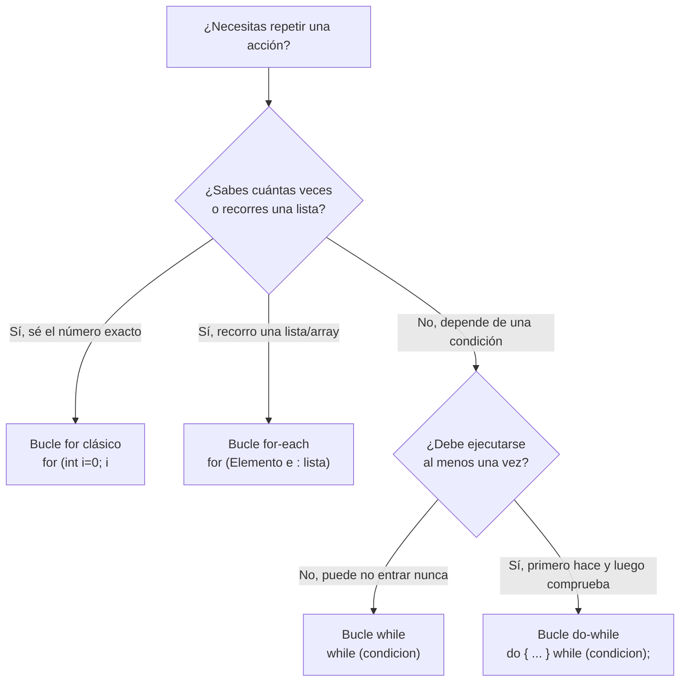

# 📘 Manual 7: Bucles, Control de Flujo, Strings y Todas las Dudas Clave

> **Carpeta de referencia:** `TeoriaExplicadaPor-IA/07_bucles_control_de_flujo_strings_y_dudas_frecuentes.md`  
> **Para qué sirve:** Este manual reúne todos los temas de **control de flujo (bucles y switch)**, **manipulación de cadenas de texto (`String`)** y el **banco de dudas resueltas** surgidas durante el desarrollo de ejercicios reales como `garaje2moto.java`. Consúltalo siempre que dudes sobre cómo repetir acciones, procesar entradas de teclado o entender qué hace una línea específica en Java.

---

## 📑 Índice de Contenidos

1. [🔁 Los 4 Tipos de Bucles (Loops) en Java: Cuándo usar cuál](#-1-los-4-tipos-de-bucles-loops-en-java-cuándo-usar-cuál)
   * [1.1. Bucle `for` clásico](#11-bucle-for-clásico-sabes-cuántas-veces-exactas-repetir)
   * [1.2. Bucle `for-each` (for mejorado)](#12-bucle-for-each-para-recorrer-listas-o-arrays)
   * [1.3. Bucle `while`](#13-bucle-while-mientras-una-condición-sea-verdadera)
   * [1.4. Bucle `do - while`](#14-bucle-do---while-se-ejecuta-al-menos-una-vez-sí-o-sí)
   * [1.5. Tabla Comparativa de Bucles](#15-tabla-comparativa-de-bucles)
2. [🔀 Toma de Decisiones: `switch` Moderno vs Clásico vs `if-else`](#-2-toma-de-decisiones-switch-moderno-vs-clásico-vs-if-else)
3. [🔤 Manejo de Cadenas (`String`) en Consola](#-3-manejo-de-cadenas-string-en-consola)
   * [3.1. ¿Qué es `.trim()` y por qué es vital en menús?](#31-qué-es-trim-y-por-qué-es-vital-en-menús)
   * [3.2. Comparar textos: `==` vs `.equals()` vs `.equalsIgnoreCase()`](#32-comparar-textos--vs-equals-vs-equalsignorecase)
   * [3.3. El operador `||` (O / OR): No significa "diferente"](#33-el-operador--o--or-no-significa-diferente)
   * [3.4. Caracteres de escape: `\n` y `\t`](#34-caracteres-de-escape-n-y-t)
4. [❓ Banco de Dudas Frecuentes de Clase (Explicadas con Manzanas)](#-4-banco-de-dudas-frecuentes-de-clase-explicadas-con-manzanas)
   * [Duda A: ¿Siempre van esos mismos métodos o depende del ejercicio?](#duda-a-siempre-van-esos-mismos-métodos-o-depende-del-ejercicio)
   * [Duda B: ¿Cómo viajan los 50 coches y 15 motos? (Carrera de relevos)](#duda-b-cómo-viajan-los-50-coches-y-15-motos-carrera-de-relevos)
   * [Duda C: ¿Por qué creamos métodos delegados (`cuantosCochesHay()`)?](#duda-c-por-qué-creamos-métodos-delegados-cuantoscocheshay)
   * [Duda D: ¿Qué significa `!= null` y por qué protege tu código?](#duda-d-qué-significa--null-y-por-qué-protege-tu-código)
   * [Duda E: ¿De dónde sale la línea de consola al sacar un coche?](#duda-e-de-dónde-sale-la-línea-de-consola-al-sacar-un-coche)
   * [Duda F: ¿Cómo funciona `try-catch` con `throw` y `e.getMessage()`?](#duda-f-cómo-funciona-try-catch-con-throw-y-egetmessage)
   * [Duda G: Disección de `public static void main(String[] args)`](#duda-g-disección-de-public-static-void-mainstring-args)

---

## 🔁 1. Los 4 Tipos de Bucles (Loops) en Java: Cuándo usar cuál

Cuando necesitas **repetir una acción varias veces**, no copias y pegas código 50 veces; utilizas un **bucle**. En Java existen exactamente 4 variantes:



---

### 1.1. Bucle `for` clásico (Sabes cuántas veces exactas repetir)
* **¿Cuándo usarlo?** Cuando sabes de antemano el número exacto de repeticiones (ej: contar del 1 al 10, repetir 50 veces).
* **Partes:** `for (inicio; condición_para_seguir; incremento)`
* **Ejemplo:**
  ```java
  // Imprime los números del 1 al 5
  for (int i = 1; i <= 5; i++) {
      System.out.println("Vuelta número: " + i);
  }
  ```

---

### 1.2. Bucle `for-each` (Para recorrer listas o arrays)
* **¿Cuándo usarlo?** Cuando tienes un `ArrayList` o un Array y quieres visitar cada elemento uno por uno sin preocuparte por índices (`i = 0`).
* **Sintaxis:** `for (TipoDeDato apodo : coleccion)`
* **Ejemplo:**
  ```java
  ArrayList<String> vehiculos = new ArrayList<>();
  vehiculos.add("Coche");
  vehiculos.add("Moto");
  vehiculos.add("Camión");

  // Lee cada vehículo de la lista
  for (String v : vehiculos) {
      System.out.println("Vehículo registrado: " + v);
  }
  ```

---

### 1.3. Bucle `while` (Mientras una condición sea verdadera)
* **¿Cuándo usarlo?** Cuando **no sabes cuántas veces** se va a repetir, porque depende de lo que haga el usuario o del estado del sistema.
* **Comprobación:** Primero comprueba. Si la condición es falsa desde el principio, **no entra ni una sola vez**.
* **Ejemplo real (el menú de nuestro garaje):**
  ```java
  boolean continuar = true;

  while (continuar) { // Mientras continuar sea true, repite el menú
      System.out.println("1. Entrada | 2. Salida | 3. Salir");
      String op = sc.nextLine().trim();
      
      if (op.equals("3")) {
          continuar = false; // Al ponerlo en false, el while termina
      }
  }
  ```

---

### 1.4. Bucle `do - while` (Se ejecuta al menos una vez sí o sí)
* **¿Cuándo usarlo?** Cuando necesitas que el código **se ejecute obligatoriamente al menos una vez** antes de verificar si debe repetirse (ej: pedir una contraseña o validar una nota).
* **Comprobación:** Primero ejecuta el cuerpo del `do`, y al final evalúa el `while (condicion);`.
* **Ejemplo:**
  ```java
  int nota;
  do {
      System.out.print("Introduce una nota válida entre 0 y 10: ");
      nota = sc.nextInt();
  } while (nota < 0 || nota > 10); // Si la nota es mala, vuelve a pedirla
  ```

---

### 1.5. Tabla Comparativa de Bucles

| Bucle | ¿Cuándo se usa? | ¿Se ejecuta si la condición arranca en falso? | Ejemplo típico |
| :--- | :--- | :---: | :--- |
| **`for` clásico** | Sabes el número exacto de vueltas. | ❌ No | Contar de 1 a 100, hacer 10 iteraciones fijas. |
| **`for-each`** | Recorrer todos los elementos de una lista o array. | ❌ No (si la lista está vacía) | Leer todos los alumnos matriculados o empleados. |
| **`while`** | Repetir mientras ocurra algo (duración incierta). | ❌ No | Menús interactivos, juegos hasta que el usuario pierde. |
| **`do - while`** | Validar entradas que deben ejecutarse al menos una vez. | ✅ **Sí, 1 vez obligatoria** | Preguntar un dato por teclado y repetir si está mal. |

---

## 🔀 2. Toma de Decisiones: `switch` Moderno vs Clásico vs `if-else`

En el ejercicio `garaje2moto.java` utilizamos la sintaxis moderna de Java para menús: **Switch con flechas (`->`)**.

### Comparativa: Switch Clásico vs Switch Moderno

```java
// FORMA CLÁSICA (Antigua - requería 'break' obligatorio para no desbordar)
switch (opcion) {
    case "1":
        entrarCoche();
        break; // Si olvidabas el break, ejecutaba el caso 2 por error
    case "2":
        salirCoche();
        break;
    default:
        System.out.println("Opción incorrecta");
}

// FORMA MODERNA (Java 14+ con flechas -> limpia y segura)
switch (opcion) {
    case "1" -> entrarCoche(); // Ejecuta solo esta línea y sale automáticamente
    case "2" -> {
        // Si necesitas varias líneas, abres llaves {}
        System.out.println("Ha elegido salida");
        salirCoche();
    }
    default -> System.out.println("Opción incorrecta");
}
```

> 💡 **Ventaja del switch con flecha (`->`):** Elimina para siempre el peligro de olvidar el `break;`. Es mucho más limpio y legible.

---

## 🔤 3. Manejo de Cadenas (`String`) en Consola

### 3.1. ¿Qué es `.trim()` y por qué es vital en menús?
* En inglés, *trim* significa "recortar" o "podar".
* En Java, `texto.trim()` **elimina todos los espacios en blanco invisibles** al principio y al final del texto.

```java
String entrada = "   1   "; 
String limpia = entrada.trim(); // Se convierte exactamente en "1"
```

Si el usuario pulsa sin querer la barra espaciadora antes de pulsar el 1, sin `.trim()` el programa diría: *"Opción inválida"*. Con `.trim()` el programa es tolerante y no falla.

---

### 3.2. Comparar textos: `==` vs `.equals()` vs `.equalsIgnoreCase()`

| Forma de comparar | ¿Qué hace? | ¿Es correcta para Strings? |
| :--- | :--- | :---: |
| `texto == "coche"` | Compara si apuntan a la **misma dirección de memoria RAM**, no si las letras son iguales. | ❌ **NUNCA usar `==` en Strings** |
| `texto.equals("coche")` | Compara el contenido exacto letra por letra respetando mayúsculas. | ✅ Correcta |
| `texto.equalsIgnoreCase("coche")` | Compara el contenido **ignorando si está en MAYÚSCULAS o minúsculas**. | ✅ **La más amigable para el usuario** |

**Ejemplo práctico:**
```java
String respuesta = "COCHE";

respuesta.equals("coche")            // Devuelve FALSE (mayúsculas no coinciden)
respuesta.equalsIgnoreCase("coche")  // Devuelve TRUE (las letras son las mismas)
```

---

### 3.3. El operador `||` (O / OR): No significa "diferente"
* **`||` significa O lógico (OR):** Basta con que se cumpla **una sola** de las condiciones para que el `if` se ejecute.
* **`&&` significa Y lógico (AND):** Se tienen que cumplir **ambas** obligatoriamente.
* **`!=` significa DISTINTO / DIFERENTE.**

```java
// Traducción: Si tecleó "1" O BIEN escribió la palabra "coche" (en mayúsculas o minúsculas)
if (tipo.equals("1") || tipo.equalsIgnoreCase("coche")) {
    entrarCoche();
}
```

---

### 3.4. Caracteres de escape: `\n` y `\t`
Cuando pones una barra invertida `\` dentro de un texto entre comillas, Java sabe que no quieres imprimir la letra, sino ejecutar una orden especial de formato:
* **`\n` (New Line):** Da un salto de línea (como pulsar la tecla *Enter*).
* **`\t` (Tab):** Inserta una tabulación (como pulsar la tecla *Tab* para alinear en columnas).

```java
System.out.println("\n=================="); // Salta una línea y luego dibuja las rayas
System.out.println("ID:\tNombre:\tNota:"); // Alinea en columnas limpias
```

---

## ❓ 4. Banco de Dudas Frecuentes de Clase (Explicadas con Manzanas)

### Duda A: ¿Siempre van esos mismos métodos o depende del ejercicio?
> **Pregunta:** *"¿Siempre tengo que crear métodos como `cuantosCochesHay()`, `getCochesQueSalieron()` o es solo por este ejercicio?"*

**Respuesta:**  
Depende del **problema que estás modelando**:
* En un **banco**: tus métodos serán `ingresar()`, `retirar()`, `consultarSaldo()`.
* En un **hospital**: tus métodos serán `ingresarPaciente()`, `darDeAlta()`, `camasLibres()`.
* En nuestro **garaje**: creamos `entrarCoche()`, `salirCoche()`, `cuantosCochesHay()`.

Lo que **sí se repite siempre** en Programación Orientada a Objetos es la categoría de métodos:
1. **Acciones (Verbos):** Modifican el estado (`entrar()`, `salir()`).
2. **Consultas (Getters):** Devuelven datos sin romper la privacidad (`cuantosHay()`, `getLimite()`).

---

### Duda B: ¿Cómo viajan los 50 coches y 15 motos? (Carrera de relevos)
> **Pregunta:** *"En el constructor `public garaje2moto(int limiteCoches, int limiteMotos)` no veo el 50 ni el 15. ¿Cómo sabe fijarlos?"*

**Respuesta:**  
Por el **encadenamiento de constructores** (*Constructor Chaining*). Es como una carrera de relevos:

```mermaid
sequenceDiagram
    autonumber
    participant Main as Método main()
    participant Garaje as garaje2moto()
    participant GarajeParams as garaje2moto(int, int)
    participant Coche as Coches(int)
    participant Padre as Vehiculos(String, int)

    Main->>Garaje: new garaje2moto()
    Note over Garaje: Invoca this(PLAZAS_FIJAS_COCHES, PLAZAS_FIJAS_MOTOS)<br/>pasa 50 y 15
    Garaje->>GarajeParams: garaje2moto(50, 15)
    Note over GarajeParams: new Coches(50)
    GarajeParams->>Coche: Coches(50)
    Note over Coche: Invoca super("Coche", 50)
    Coche->>Padre: Vehiculos("Coche", 50)
    Note over Padre: this.limite = 50;<br/>this.tipo = "Coche";
```

El valor `50` arranca en la constante `PLAZAS_FIJAS_COCHES`, pasa por `this(...)`, salta a `new Coches(50)`, sube por `super("Coche", 50)` y finalmente la clase padre `Vehiculos` lo guarda en su atributo `limite`.

---

### Duda C: ¿Por qué creamos métodos delegados (`cuantosCochesHay()`)?
> **Pregunta:** *"¿Por qué hacemos `public int cuantosCochesHay() { return this.seccionCoches.cuantosHay(); }` si parece redundante?"*

**Respuesta:**  
Por el **Principio de Encapsulamiento y la Metáfora del Recepcionista**:
* `garaje2moto` es el recepcionista del edificio.
* Los atributos `seccionCoches` y `seccionMotos` son privados (`private`). Nadie desde la calle puede entrar a tocarlos directamente.
* Cuando un cliente en el menú pregunta cuántos coches hay, le pregunta al recepcionista (`garaje.cuantosCochesHay()`), y el recepcionista le pide el dato a su especialista (`this.seccionCoches.cuantosHay()`).

---

### Duda D: ¿Qué significa `!= null` y por qué protege tu código?
> **Pregunta:** *"¿Qué significa `if (this.led != null)`?"*

**Respuesta:**  
* `null` significa **vacío, no inicializado, nada en memoria**.
* `!=` significa **distinto de**.
* `this.led != null` se traduce como: **"Si el semáforo LED realmente existe y está conectado"**.

Si intentas encender una bombilla que no existe (`led = null`), Java se estrella con el error fatal `NullPointerException`. Comprobar `!= null` antes de usar un objeto es **programación defensiva**.

---

### Duda E: ¿De dónde sale la línea de consola al sacar un coche?
> **Pregunta:** *"Al pulsar 'Salida', sale en consola: `Salió Coche. Dentro: 0 | Total salidos: 1`. ¿De dónde sale esa línea?"*

**Respuesta:**  
Sale directamente del método `salir()` programado dentro de la superclase `Vehiculos`:
```java
// Dentro de Vehiculos.java:
public void salir() {
    this.dentro--;
    this.queSalieron++;
    // ¡ESTA ES LA LÍNEA QUE SE IMPRIME!
    System.out.println("Salió " + this.tipo + ". Dentro: " + this.dentro + " | Total salidos: " + this.queSalieron);
}
```
Como `Coches` hereda de `Vehiculos`, cuando ejecutas `seccionCoches.salir()`, se ejecuta ese código y se imprime en pantalla.

---

### Duda F: ¿Cómo funciona `try-catch` con `throw` y `e.getMessage()`?
> **Pregunta:** *"¿Cómo viaja el mensaje de error y por qué usamos `try-catch`?"*

**Respuesta:**  
Es como un sistema de alarma con red de seguridad:
1. **El sensor (`throw`):** Si el garaje está lleno, el método lanza una alarma:
   ```java
   throw new IllegalStateException("Error: El espacio está lleno.");
   ```
2. **La red de seguridad (`try-catch`):** Si no tuviéramos `try-catch`, el programa se rompería y se cerraría de golpe. Al envolverlo en un `try`:
   ```java
   try {
       entrarCoche();
   } catch (IllegalStateException e) {
       // Atrapa la alarma en la variable 'e'
       System.out.println(e.getMessage()); // Muestra solo el texto limpio
   }
   ```
3. **Resultado:** El usuario lee el aviso del error, y el programa **sigue vivo** mostrando el menú principal otra vez.

---

### Duda G: Disección de `public static void main(String[] args)`
> **Pregunta:** *"¿Qué significa cada una de esas palabras sagradas de Java?"*

**Respuesta:**

```
public      --> Accesible desde fuera por la Máquina Virtual de Java (JVM).
static      --> No necesita que crees un objeto previo con 'new' para arrancar.
void        --> No devuelve ningún valor numérico ni textual al terminar.
main        --> Nombre exacto que la JVM busca como puerta de entrada al programa.
String[] args -> Mochila de parámetros o palabras recibidas desde la terminal.
```

---

## 🧭 ¿Cómo se conecta este tema con los demás manuales?

* Para ver operadores matemáticos y Scanner básico: 👉 [**01_fundamentos_operadores_y_entrada_salida.md**](./01_fundamentos_operadores_y_entrada_salida.md)
* Para ver `new`, `this` y clases: 👉 [**02_poo_clases_objetos_new_this_y_encapsulacion.md**](./02_poo_clases_objetos_new_this_y_encapsulacion.md)
* Para ver relaciones y excepciones a fondo: 👉 [**03_relaciones_entre_clases_y_control_de_excepciones.md**](./03_relaciones_entre_clases_y_control_de_excepciones.md)
* Para ver `super` y herencia: 👉 [**04_herencia_polimorfismo_static_y_casos_reales.md**](./04_herencia_polimorfismo_static_y_casos_reales.md)
* Para ver la plantilla de `garaje2moto.java` comentada: 👉 [**garaje2moto.java**](../CursoCompleto250/segundaSemana/practicas/TercerDia/garaje2moto.java)
