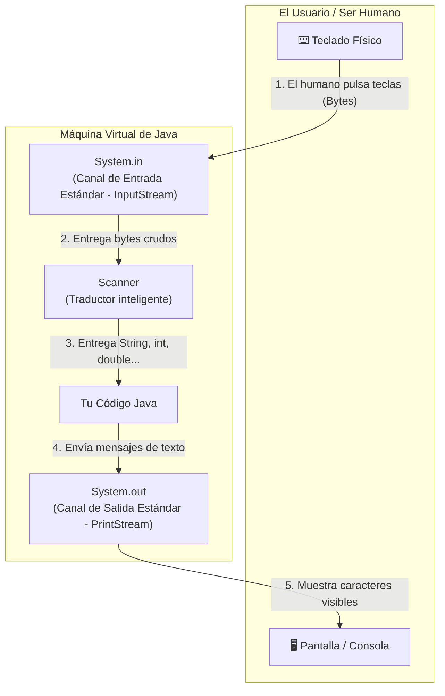

# 📘 Manual 8: Comunicación con el Humano (`System.in` vs `System.out`) y Guía Completa de `Scanner`

> **Carpeta de referencia:** `TeoriaExplicadaPor-IA/08_entrada_salida_system_in_out_y_guia_completa_scanner.md`  
> **Para qué sirve:** Comprender en profundidad cómo se comunica Java con el hardware (pantalla y teclado), qué significa exactamente `System.in`, y tener la lista definitiva de todos los tipos de datos que puede leer la herramienta `Scanner`.

---

## 🔍 1. ¿Qué teníamos documentado y qué faltaba?

* En el **Manual 01** teníamos anotado lo básico: cómo imprimir con `println`/`printf`, los 4 métodos típicos de Scanner (`nextLine`, `nextInt`, `nextDouble`, `nextBoolean`) y el truco de limpiar el buffer.
* **Lo que faltaba y explicamos aquí:**
  1. ¿Qué es exactamente `System.in` frente a `System.out` y por qué uno es el teclado y otro la pantalla?
  2. ¿Por qué necesitamos a `Scanner` si ya existe `System.in`?
  3. La lista **completa** de todos los métodos `next...()` de `Scanner` (incluyendo `long`, `float`, `byte`, `short` y palabras sueltas con `next()`).
  4. ¿Cómo leer un solo carácter (`char`) si en Java **no existe `nextChar()`**?
  5. Métodos de comprobación preventiva (`hasNextInt()`, etc.).

---

## 🔌 2. `System.in` frente a `System.out` (La Anatomía de la Comunicación)

La clase `System` de Java es el puente que conecta tu programa con el sistema operativo de tu ordenador (Windows, Linux o Mac):



### 1. `System.out` (Salida Estándar)
* **Significado:** *System* (El Sistema) + *out* (Output / Salida).
* **Destino habitual:** La **pantalla** o ventana de la terminal.
* **Misión:** Es el altavoz por donde Java habla al usuario usando `print()`, `println()` o `printf()`.

### 2. `System.in` (Entrada Estándar)
* **Significado:** *System* (El Sistema) + *in* (Input / Entrada).
* **Origen habitual:** El **teclado físico**.
* **Misión:** Es el micrófono que detecta cuando el ser humano pulsa teclas en la consola.

### 🤔 ¿Por qué `System.in` necesita a `Scanner`?
`System.in` es un canal muy primitivo (un flujo de bytes en bruto / `InputStream`).  
Si pulsas la tecla `5`, `System.in` no sabe que es un número matemático; solo recibe el byte binario `00110101` (el código ASCII 53).

**`Scanner` es el traductor inteligente:**
Al escribir `new Scanner(System.in)`, conectas el traductor al cable del teclado para que procese esos bytes y los convierta en tipos de datos útiles de Java (`int`, `double`, `String`, etc.).

---

## 📋 3. La Familia Completa de Métodos de `Scanner`

Cuando tienes un escáner creado (ejemplo: `Scanner sc = new Scanner(System.in);`), puedes pedirle que lea cualquier tipo de dato:

| Método en Java | Tipo devuelto | ¿Qué lee exactamente? | Ejemplo de entrada |
| :--- | :---: | :--- | :--- |
| **`sc.nextLine()`** | `String` | Lee **la línea completa** hasta que pulsas *Enter* (incluye espacios entre palabras). | `"Carlos Pérez"` |
| **`sc.next()`** | `String` | Lee solo **una palabra** (se corta en cuanto encuentra el primer espacio en blanco). | `"Carlos"` |
| **`sc.nextInt()`** | `int` | Lee un **número entero estándar** (de -2.147 millones a +2.147 millones). | `25`, `-8` |
| **`sc.nextDouble()`** | `double` | Lee un **número decimal de doble precisión** (el estándar para dinero o medidas). | `4.50`, `19.99` |
| **`sc.nextFloat()`** | `float` | Lee un **número decimal simple** (menos precisión que double). | `3.14` |
| **`sc.nextLong()`** | `long` | Lee un **entero gigantesco** (más de 2.000 millones). | `9876543210` |
| **`sc.nextBoolean()`** | `boolean` | Lee estrictamente un valor booleano (`true` o `false`). | `true`, `false` |
| **`sc.nextByte()`** | `byte` | Lee un entero diminuto de 8 bits (de -128 a 127). | `12` |
| **`sc.nextShort()`** | `short` | Lee un entero corto de 16 bits (de -32.768 a 32.767). | `1500` |

---

## 🔤 4. El Caso Raro: ¿Cómo se lee un solo carácter (`char`)?

En Java **NO existe el método `sc.nextChar()`**.

Si quieres pedir una sola letra o confirmación (por ejemplo `S` para Sí o `N` para No), se utiliza este truco estándar:

```java
System.out.print("¿Desea imprimir la factura? (S/N): ");

// 1. sc.next() lee la palabra introducida (ej: "Si")
// 2. .charAt(0) se queda con la letra que está en la posición cero (la primera letra: 'S')
char opcion = sc.next().charAt(0);

if (opcion == 'S' || opcion == 's') {
    System.out.println("Imprimiendo...");
}
```

---

## 🛡️ 5. Métodos Preventivos: ¿Cómo saber qué escribió antes de fallar?

Si le pides al usuario un número con `sc.nextInt()` y el usuario teclea `"hola"`, el programa explota con una excepción `InputMismatchException`.

Para evitar que el programa se rompa, `Scanner` tiene métodos con el prefijo **`hasNext...`** que devuelven `true` o `false` para mirar sin consumir:

```java
System.out.print("Introduce tu edad en números: ");

if (sc.hasNextInt()) {
    int edad = sc.nextInt(); // Solo entra si de verdad escribió números
    System.out.println("Edad registrada: " + edad);
} else {
    System.out.println("Error: No has introducido un número entero válido.");
    sc.nextLine(); // Limpiamos la basura del teclado
}
```

---

## 🚪 6. Buena Práctica Profesional: Cerrar el Escáner

Cuando ya no vayas a pedir más datos al usuario en todo el programa, es una excelente costumbre cerrar el escáner para liberar el recurso:

```java
sc.close(); // Cierra el flujo de lectura y libera recursos del sistema operativo
```

---

## 🧭 Conexión con los demás manuales:
* Para ver `print`, `println` y operadores: 👉 [**01_fundamentos_operadores_y_entrada_salida.md**](./01_fundamentos_operadores_y_entrada_salida.md)
* Para ver bucles y manejo de cadenas (`trim`, `equals`): 👉 [**07_bucles_control_de_flujo_strings_y_dudas_frecuentes.md**](./07_bucles_control_de_flujo_strings_y_dudas_frecuentes.md)
* Para ver el ejercicio real resuelto de supermercado: 👉 [**FacturaSupermercado.java**](../EjercicioPracticos-AI/MetiendomeCañaConJava_YoSolo/FacturaSupermercado.java)
